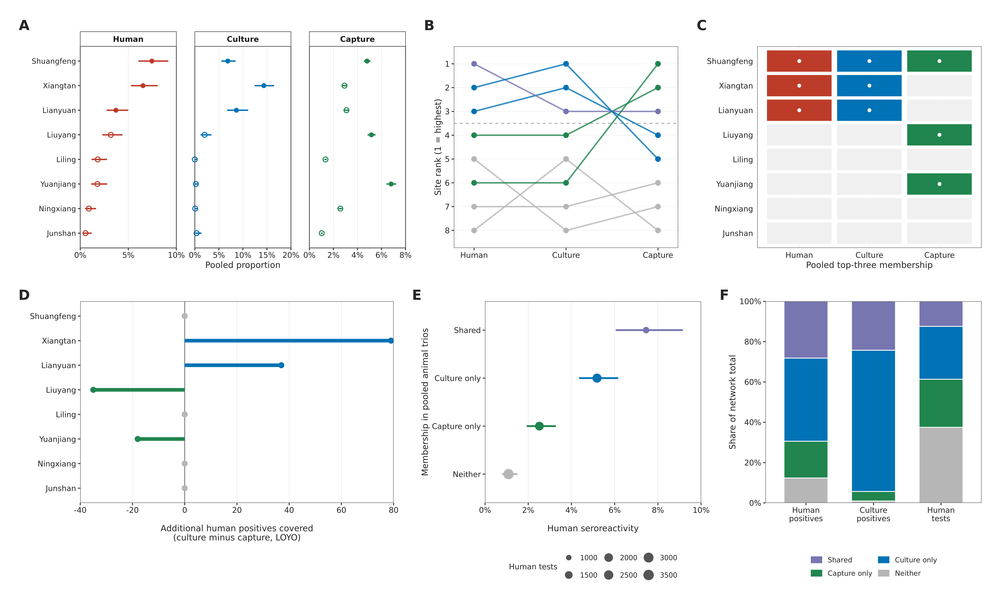
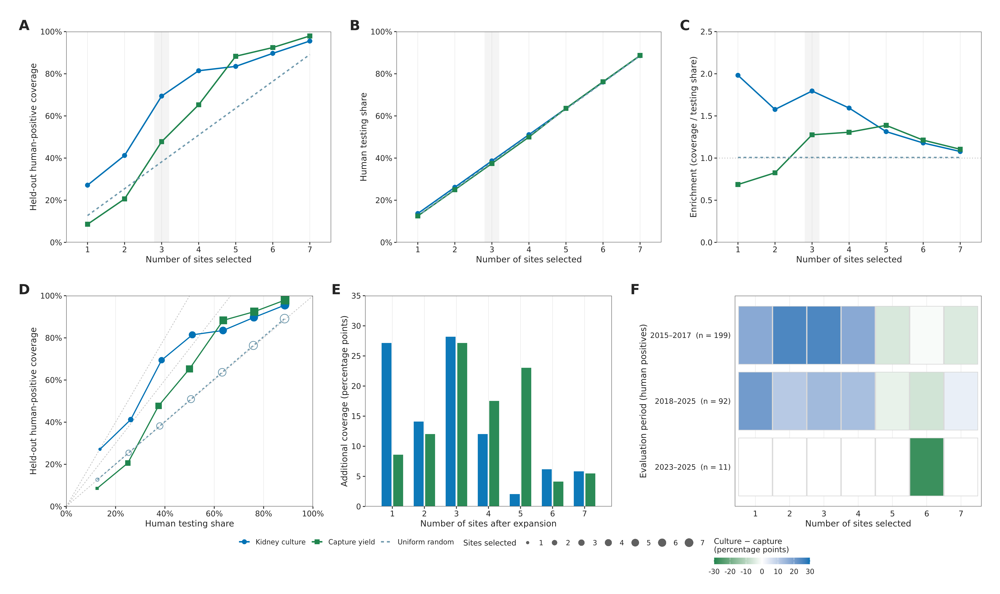
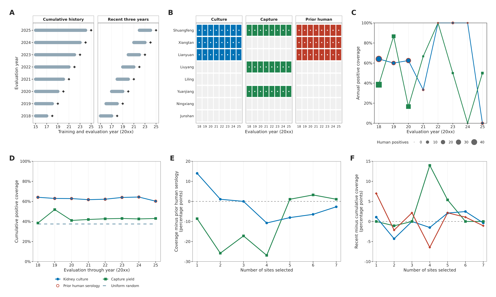

## Title page

**Title:** Selecting leptospirosis sentinel sites using rodent surveillance: a retrospective evaluation in Hunan, China, 2015–2025

**Short title:** Rodent indicators for leptospirosis sentinel selection

**Authors:** Ziyan Liua,b,†, Kangguo Lic,†, Jingyu Chengc,†, Zheni Bua, Zhihui Daia, Ziqi Yanga, Mingxia Xiaoa, Jia Ruid,‡, Tianmu Chenc,‡, Kaiwei Luoa,b,c,‡

**Affiliations:**

a. Hunan Provincial Center for Disease Control and Prevention, Changsha, China.

b. Hunan Workstation for Emerging Infectious Disease Control and Prevention, Chinese Academy of Medical Sciences, Changsha, China.

c. State Key Laboratory of Vaccines for Infectious Diseases, Xiang An Biomedicine Laboratory, National Innovation Platform for Industry-Education Integration in Vaccine Research, School of Public Health, Xiamen University, Xiamen, China.

d. Department of Epidemiology and Health Statistics, Xiangya School of Public Health, Central South University, Changsha, China.

† Ziyan Liu, Kangguo Li and Jingyu Cheng contributed equally as joint first authors.

‡ K.W. Luo (87616498@qq.com), T.M. Chen (chentianmu@xmu.edu.cn), and J. Rui (ruijia5345@163.com) contributed equally as joint corresponding authors.

## Abstract

**Background:** Human and animal surveillance can inform leptospirosis sentinel-site selection, but different animal indicators may prioritise different locations. We evaluated how rodent indicator choice and network size affected coverage of recorded human seropositive results in Hunan, China.

**Methodology/Principal Findings:** We linked human serology, rodent kidney-culture and trapping records from eight sites during 2015–2025. Retrospective forward evaluation selected one to seven sites for each year during 2018–2025 using only earlier records, with prior human serology as a benchmark. Leave-one-year-out evaluation assessed historical coverage across 87 jointly observed site–years. Coverage was the proportion of recorded human microscopic agglutination test positives at selected sites, interpreted alongside their share of testing. In the three-site forward evaluation, culture-based selection covered 60.2% (56/93) of positives in 38.5% of tests, compared with 43.0% (40/93) in 36.8% of tests for capture-based selection. Prior human serology selected the same three sites as culture in every year. In both evaluations, culture covered more positives at one to four sites, whereas capture covered more at five to seven. Three-site leave-one-year-out coverage was 69.4% (202/291) versus 47.8% (139/291; exact trajectory-permutation $P=0.471$). Of the net difference of 63 positives, 50 occurred in 2015–2017. The modelled difference in coverage between fixed three-site selections was 10.4 percentage points (95% credible interval −6.7 to 27.1).

**Conclusions/Significance:** The relative coverage of rodent-based selection rules depended on network size and surveillance history. These findings support evaluating the animal indicator together with the number of sites retained and the historical data used for selection.

## Author Summary

Leptospirosis can spread to people through water or soil contaminated by infected animals. Programmes monitoring this disease collect information from people and rodents, but these sources may point to different places for surveillance. We used eleven years of records from eight sites in Hunan, China, to compare two ways of selecting sites: how often rodents were caught and how often bacteria were grown from rodent kidney samples. We measured the share of recorded human antibody-positive results found at the selected sites. When earlier records were used to select three sites for subsequent years, the culture rule covered about 60% of positive results, compared with 43% for the capture rule. Previous human antibody results selected the same three sites as culture. However, capture-based selection covered more positives when five to seven sites were retained. Our findings suggest that programmes should assess the animal indicator together with the number of sites they plan to retain. Updating these selections requires continued data collection across candidate sites. The analysis focused on antibody evidence of previous exposure.

## 1. Introduction

Sentinel-site selection determines where a surveillance programme observes disease and exposure. For leptospirosis, human serology, animal trapping and pathogen detection provide complementary information that may lead to different site priorities. Rodents and other mammals can carry leptospires in their kidneys and shed them into the environment, exposing people through contaminated water and soil [1–3]. Changes in the epidemiology of leptospirosis in China [4,5] make it useful to examine how these routinely collected data can guide the allocation of sampling effort within existing networks.

Hunan's leptospirosis programme combines healthy-population serology with rodent trapping and kidney culture. An earlier report described human cases and annual surveillance findings during 2018–2022 [6]. Integrated surveillance programmes are intended to connect information across sources to support public-health decisions [7–9]. One such decision is which sites to retain when human exposure surveillance is concentrated at a subset of existing locations. For programmes considering this approach, a practical question is what share of recorded human seropositive results would be represented by each selection rule at a given network size.

Rodent capture yield and kidney-culture positivity provide different biological information. Captures per trap-night reflect rodent abundance and capture probability under local trapping conditions; culture positivity measures recovery of viable leptospires from evaluable kidney cultures. Host composition, infection frequency and laboratory recovery can therefore produce different site rankings [10–12]. Longitudinal ecological work has shown that rodent density and infection prevalence can vary differently [13]. Recent surveillance studies in China have also examined animal and human indicators [14,15], while a community cohort in Brazil linked rodent abundance to human infection within an environmental context [16]. These findings motivate a comparison of how well capture-based and culture-based site selections represent human seroreactivity within the same surveillance network.

We addressed this question using 2015–2025 records from eight Hunan sentinel sites. Microscopic agglutination test (MAT) seroreactivity among healthy residents provides evidence of previous exposure [17]. We evaluated selections based only on records available before each subsequent year, using historical human serology as a benchmark, and compared these results with a leave-one-year-out historical evaluation. Across network sizes of one to seven sites, we examined which sites were selected and the share of recorded human seropositive results they contained. The relative coverage of the animal rules changed with network size, providing a basis for assessing indicator choice within an existing surveillance network.

## 2. Methods

### Ethics statement

This study was approved by the Ethics Committee of the Hunan Center for Disease Control and Prevention (approval no. IRB-2025-015-01). This retrospective secondary analysis used existing aggregated human and animal sentinel-surveillance counts from the Hunan provincial programme described by Zhang and colleagues [6]. The counts were compiled under the National Leptospirosis Surveillance Protocol and are held by the Hunan Center for Disease Control and Prevention. The analysis did not use individual-level records or personal identifiers, recruited no participants, and performed no additional human sampling or animal procedures.

### 2.1. Surveillance records and analytical populations

We conducted a retrospective evaluation of aggregated surveillance ledgers held by the Hunan Center for Disease Control and Prevention. The provincial programme operates under the national leptospirosis surveillance protocol [18]. Records were linked by calendar year and site: Junshan, Liling, Lianyuan, Liuyang, Ningxiang, Shuangfeng, Xiangtan and Yuanjiang. Surveillance findings for 2018–2022 from the same programme have been published previously [6]. This analysis extends the period to 2015–2025 and uses site-level records to compare alternative selection rules. The relationship between published annual counts and the present analysis is documented in Table S32.

Human records were available for all 88 site–years. Rodent trapping and culture were recorded in 87; Yuanjiang did not conduct animal surveillance in 2018. We used the 87 jointly observed records for pooled indicator comparisons, leave-one-year-out (LOYO) evaluation and statistical modelling. For the forward evaluation, which selected sites using only previous-year records, human outcomes from all eight sites were retained, including Yuanjiang's 2018 result of 1/100. Its earlier animal records remained available for selection. The analytical populations are detailed in Tables S2 and S27.

Human seroreactivity was defined as the proportion of tested healthy residents recorded as MAT positive at the reported titre threshold of at least 1:50 [18,19]. Human positive counts were taken from site-level records and reconciled with age-group totals. Kidney-culture positivity was positive isolates divided by recorded effective cultures; capture yield was rodents caught divided by trap-nights. We applied these ratio definitions consistently across years; the aggregate ledgers did not establish whether field and laboratory procedures were unchanged. Four site–years had effective-culture counts that differed from inoculated cultures minus contaminated tubes; the recorded counts were primary and the arithmetic alternative was examined in sensitivity analysis (Table S21). Species composition was descriptive. The available ledgers contained aggregate counts without individual titres, sampling dates, field coordinates or individual capture-to-culture links. Reporting was guided by the applicable Checklist for One Health Epidemiological Reporting of Evidence (COHERE) and Strengthening the Reporting of Observational Studies in Epidemiology (STROBE) items [20,21]; protocol details are provided in Supplementary Methods S1 and S8.

### 2.2. Site-selection rules and coverage measures

For each training dataset, we ranked sites in descending order of culture positivity or capture yield, calculated from pooled numerator and denominator counts. Each selected subset is referred to as a portfolio. We evaluated the complete network-size curve from one to seven sites ($k=1,\ldots,7$), with the three-site comparison ($k=3$) as the focal illustration. A uniform-random reference assigned equal probability to each eligible combination of $k$ sites. When rates tied at the selection boundary, all admissible combinations were weighted equally. No human result from the evaluation year was used to select an animal-ranked portfolio or resolve ties.

The decision scenario concerned concentrating human serological sampling at a subset of existing sites, using historical animal data from the full candidate network. Annual animal-based updating uses animal surveillance across the candidate sites. We evaluated subsets of the observed records without reallocating tests from unselected to selected sites.

Coverage ($C$) was the fraction of human seropositive results located at the selected sites. Testing share ($S$) was the corresponding fraction of human tests, and enrichment was $E=C/S$. Thus, enrichment expressed the concentration of recorded positives relative to the share of testing represented. For pooled summaries, selected positive counts and testing totals were summed across evaluation years before calculating the ratios. For tied or random selections, these counts were averaged over admissible portfolios. Annual coverage was undefined when a year contained no human positives; its testing counts were retained in pooled calculations. These measures quantify representation of recorded results within the observed surveillance network. To interpret portfolio membership, we summarised human seroreactivity and the distribution of recorded positives across sites shared by the pooled animal-ranked trios, sites selected only by culture, sites selected only by capture, and sites selected by neither. Marginal coverage was the change when one further site was added to a ranking.

### 2.3. Leave-one-year-out historical evaluation

In each of 11 folds, animal counts from all years except the evaluation year were pooled to rank sites. Selection and scoring were restricted to the sites in that year's joint panel: seven in 2018 and eight otherwise. Each rule was evaluated at every $k$. LOYO draws on records before and after the omitted year and measures coverage within the historical series. We also calculated full-period fixed-ranking curves for comparison (Tables S8–S9; Figure S3).

For the focal three-site comparison, complete human trajectories were permuted among animal-site labels with identical observation patterns, preserving within-site temporal structure. Yuanjiang's ten-year trajectory remained fixed, giving 5,040 assignments. Two-sided permutation P values were calculated from the absolute distance of each statistic from its permutation median. A balanced-panel sensitivity analysis omitted 2018 and enumerated all 40,320 assignments. Comparisons across the other network sizes used the same coverage framework. Pooled site concordance was summarised using Spearman correlations and exact site-label permutations, with leave-one-site-out influence analyses (Supplementary Methods S2).

### 2.4. Evaluation using only previous years

We initialised rankings with 2015–2017 records and evaluated site selections in each year from 2018 through 2025. The primary forward evaluation pooled all available records from 2015 through the year before evaluation. Alongside the two animal rules, a prior-human-serology rule ranked sites by their previous positive/tested ratios. All rules selected from the same eight sites, using valid historical records for the relevant stream. Availability of animal records in the evaluation year did not determine eligibility. We then evaluated each selection against the human results recorded in that year. The prior-human-serology benchmark used the complete available human history across candidate sites.

A recent-three-year sensitivity analysis used only the three years immediately preceding each evaluation year. We evaluated both updating approaches at every network size and retained all annual selections and counts (Tables S28–S33). The three-year initialisation, cumulative-history rule and recent-history sensitivity used separate selection and outcome years. The modelled intervals below concern the two fixed portfolios, while LOYO and forward evaluation use different evaluation periods and outcome panels.

### 2.5. Year-standardised estimates and supporting analyses

To examine site heterogeneity after accounting for calendar year and extra-binomial variation, human and culture counts in the 87-row panel were modelled separately with beta-binomial likelihoods and additive site and year effects on the logit scale. Parallel binomial fits assessed likelihood sensitivity. Models used zero-sum orthonormal contrasts and were fitted in PyMC using the No-U-Turn Sampler (NUTS). We assessed convergence and posterior predictive behaviour with ArviZ [22,23]. Primary models retained 6,000 draws from four chains. Full priors, diagnostics and sensitivity specifications are given in Supplementary Methods S3–S6.

For each posterior draw, site rates were standardised by averaging conditional mean probabilities over the 11 calendar years. Modelled expected coverage was the share of expected human positives at a fixed trio, weighted by observed site testing totals. We compared the pooled culture trio (Lianyuan, Shuangfeng and Xiangtan) with the pooled capture trio (Liuyang, Shuangfeng and Yuanjiang), reporting the paired difference and its 95% credible interval. This estimate reports expected coverage for the two fixed portfolios alongside the observed LOYO and forward results. Further analyses examined period-specific coverage, culture-denominator definitions and prior sensitivity. Independent implementations checked the selection weights, training windows and evaluation counts against the source panel.

## 3. Results

### 3.1. Surveillance indicators identified different site priorities

The 87 jointly observed site–years contained 291 positive results among 8,834 human tests, 317 positive cultures among 6,824 effective kidney cultures, and 7,333 captures over 270,469 trap-nights (Table 1). Including Yuanjiang's 2018 human observation yielded 292 positive results among 8,934 tests in the complete 88-row human ledger. The 2018–2025 forward evaluation comprised 93 positives among 6,525 tests at all eight sites (Table S27).

Pooled human seroreactivity ranged from 0.55% in Junshan to 7.45% in Shuangfeng, and culture positivity ranged from 0.00% in Liling to 14.36% in Xiangtan. The culture-leading sites—Xiangtan, Lianyuan and Shuangfeng—were also the three sites with the highest pooled human seroreactivity, although their order differed (Figure 1). Together, these sites accounted for 299/317 (94.3%) positive cultures and 202/291 (69.4%) human positives. Capture yield instead prioritised Yuanjiang, Liuyang and Shuangfeng. Xiangtan ranked first for culture positivity but fifth for capture yield (2.92%); Yuanjiang ranked first for capture yield (6.81%) and sixth for culture positivity (0.21%). Trapping records attributed 94.6% of Xiangtan captures and 88.2% of Yuanjiang captures to *Apodemus agrarius*. In the pooled animal trios, culture-only sites contained 120 positive human results among 2,315 tests (5.18%), compared with 53/2,106 (2.52%) at capture-only sites; Shuangfeng was shared by both trios (Figure 1E–F).

The observed Spearman rank correlation between human seroreactivity and culture positivity was 0.714 (exact $P=0.0576$), compared with 0.429 between human seroreactivity and capture yield ($P=0.299$). Culture and capture were weakly aligned ($\rho=0.286$, $P=0.501$). Human–culture correlations remained positive when any single site was omitted (0.571–0.786; Table S3).

### 3.2. Coverage depended on indicator choice and network size

Culture selected Lianyuan, Shuangfeng and Xiangtan in every three-site LOYO fold. Capture selected Liuyang, Shuangfeng and Yuanjiang, with Lianyuan replacing Yuanjiang in the seven-site 2018 fold. Culture-selected sites covered 202/291 human positives (69.4%) in 3,415/8,834 tests (38.7%); capture-selected sites covered 139/291 positives (47.8%) in 3,306/8,834 tests (37.4%). Enrichment was 1.80 and 1.28, respectively (Table 2). The coverage difference was 21.6 percentage points and the enrichment difference was 0.519; exact trajectory-permutation probabilities were 0.471 and 0.505. The uniform-random three-site reference covered an expected 38.2% of positives.

Across the full LOYO network-size curve, culture covered more positives when one to four sites were selected, whereas capture covered more when five to seven sites were selected (Figure 2; Table S28). At four sites, coverage was 81.4% for culture and 65.3% for capture; at five sites, it was 83.5% and 88.3%. The largest incremental gains occurred at the first and third sites for culture, and at the third and fifth sites for capture (Figure 2E). The full-period fixed-ranking comparison showed the same direction of change across network sizes, with distinct numerical values because it used a single pooled ranking (Figure S3).

The net difference of 63 positive results covered by the two rules was concentrated in 2015–2017. These years accounted for 50 of the 63 additional positives covered by culture selection and 199 of the 291 positives overall. Xiangtan contributed 79 positive results to the culture-minus-capture contrast, partly offset by capture's inclusion of Liuyang and Yuanjiang (Figure 1D; Tables S5–S6). Within-period LOYO evaluation restricted to 2018–2025 yielded similar coverage, 54/92 for culture and 53/92 for capture (Table S19).

### 3.3. Culture and prior human serology selected the same three sites in forward evaluation

In the forward evaluation, cumulative animal records again selected Lianyuan, Shuangfeng and Xiangtan for culture, and Liuyang, Shuangfeng and Yuanjiang for capture, in all eight evaluation years. Culture covered 56/93 subsequent human positives (60.2%) in 2,512/6,525 tests (38.5%), compared with 40/93 positives (43.0%) in 2,400/6,525 tests (36.8%) for capture. Enrichment was 1.56 versus 1.17, and the observed coverage difference was 17.2 percentage points (Figure 3; Table 2). The prior-human-serology rule selected the same trio as culture in every year and therefore had identical coverage. Random selection of three of eight sites had expected coverage of 37.5%.

The complete human ledger allowed Yuanjiang to be scored in 2018 using its earlier animal records. In that year, capture selection covered 15/39 human positives, compared with 18/38 under the seven-candidate LOYO design. Annual counts also showed variation in relative coverage: during 2023–2025, the cumulative-history culture and capture rules each covered 5/11 positives (Table S33).

Across the cumulative-history forward evaluation, culture covered more positives at one to four sites and capture at five to seven, reproducing the crossover observed in LOYO evaluation. At five sites, coverage was 75.8% for culture and 84.9% for capture (Table S28). With four sites, culture covered 68.8% of positives, capture 52.7% and prior human serology 79.6%. Thus, the agreement between culture and prior human serology at three sites did not extend to every network size (Figure 3E; Figure S3). Updating rankings from only the preceding three years yielded the same aggregate three-site totals for culture and capture (56/93 and 40/93); prior human serology covered 58/93 (62.4%; Figure 3F). Full network-size curves and selections, including averaged boundary ties, are reported in Tables S28–S30.

### 3.4. Year-standardised coverage estimates and uncertainty

The beta-binomial model estimated mean expected coverage of 55.2% for the fixed culture trio and 44.8% for the fixed capture trio. Their paired difference averaged 10.4 percentage points (95% credible interval −6.7 to 27.1), with an 88.5% posterior probability of greater expected coverage for culture (Table 2; Tables S13–S14). Beta-binomial predictive intervals accommodated the observed numbers of zero-positive site–years more closely than the binomial model (Figure S1). The probability of identical human and culture top-three sets was 0.278 under the beta-binomial model and 0.750 under the binomial model (Figure S4).

On the balanced panel excluding 2018, three-site LOYO culture coverage was 177/253 compared with 121/253 for capture; the enrichment-comparison $P$ value was 0.338. Prior, likelihood, denominator and period sensitivity results are reported in Tables S17–S21. All 14 model fits met the specified sampling diagnostic criteria.

## 4. Discussion

In the three-site forward evaluation, selections based on previous-year rodent culture records covered 60.2% of subsequent recorded human positives, compared with 43.0% for selections based on capture yield, at similar shares of human testing. Historical human serology selected the same three sites as culture. Both the forward and LOYO evaluations showed that relative coverage changed with network size. This study connects routinely collected animal indicators to a practical surveillance decision: which existing sites to retain for human serological sampling, and how the share of recorded positives changes with the number of sites retained.

The different rankings are biologically plausible. Capture yield combines local rodent abundance with trapping conditions and capture probability, while kidney culture provides information on viable pathogen recovery. The contrast between Xiangtan and Yuanjiang occurred despite *A. agrarius* being the dominant captured species at both sites. Infection frequency, selection of animals for culture and laboratory recovery could each contribute. Earlier Hunan surveys document human exposure and animal carriage in the province [24,25], while ecological work elsewhere demonstrates that host density and infection prevalence can follow different patterns [13]. Several of these mechanisms may contribute to the contrasting site rankings.

Related studies also indicate that an indicator's usefulness depends on the surveillance setting and outcome. The recent Pan'an study reported an association of rodent density with human cases, with no corresponding association for animal positivity rates [15]. Studies in Fujian describe long-term variation in human and animal surveillance [14], and the Brazilian community cohort linked rodent abundance and human infection in a detailed environmental setting [16]. Our endpoint was MAT seroreactivity among healthy residents, a marker of previous exposure. The comparison therefore adds evidence about which existing sites represent that endpoint, complementing research on clinical incidence and local transmission processes.

Network size shaped the relative coverage of the two animal rules. In both the 2015–2025 LOYO and 2018–2025 cumulative-history forward evaluations, culture-selected sites covered more recorded positives at one to four sites, whereas capture-selected sites covered more at five to seven. Culture rankings initially included locations with substantial human seroreactivity that ranked lower for capture yield. As the network expanded, the remaining sites determined the marginal gains in coverage. Site-selection rules therefore need to be evaluated at the intended network size. Coverage and testing share can inform this comparison alongside fieldwork, laboratory requirements and geographic accessibility.

The forward evaluation compared the information provided by historical animal and human records. Cumulative culture and prior human serology selected identical three-site portfolios in every evaluation year. At four sites, prior human serology covered more subsequent positive results than either animal rule. Historical human serology thus provided an informative benchmark, with agreement between rules depending on network size. At three sites, culture and historical human serology identified the same priorities. Further work can assess culture-based selection where animal records are available but a comparable human baseline is limited.

Implementation depends on which surveillance streams continue after site selection. Concentrating human sampling while retaining animal monitoring across candidate sites would support the animal-based updates evaluated here. The human-history benchmark would additionally require human sampling outside the selected subset. Closing all surveillance at unselected sites would change the available information and require a different updating strategy, such as periodic surveys across the full candidate network. Testing share can be considered alongside the operational requirements of maintaining these information streams and geographic representation.

The temporal results highlight the importance of the surveillance history used for selection. Early years contributed most human positives and most of the LOYO coverage difference. In the 2018–2025 forward evaluation, cumulative-history culture selection covered more positives than capture selection, although both rules covered 5/11 positives during 2023–2025. Using only the preceding three years left the aggregate three-site coverage unchanged for both animal rules, whereas within-period LOYO evaluation for 2018–2025 yielded similar coverage between them. These results show that the training window and evaluation period are relevant to interpreting performance; the updating schedule can be specified and assessed alongside network size.

The evaluation covers eight existing sentinel sites. The three-site culture advantage was consistent in point estimates; trajectory-permutation results and the modelled 95% credible interval quantify the remaining variation. The aggregate records lacked sampling dates, locations and individual capture-to-culture links, and did not permit assessment of participant overlap or procedural comparability across site–years. Modelled coverage was based on the two fixed portfolios and observed testing volumes. Future evaluations can assess subsequent serological coverage, geographic representation and operational costs.

## 5. Conclusions

Rodent culture positivity and capture yield identified different sentinel-site priorities in Hunan, with relative coverage of recorded human seropositive results depending on network size. In both LOYO and cumulative-history forward evaluations, culture-selected sites covered more recorded positives at one to four sites, while capture-selected sites covered more at five to seven. Historical culture and human serology agreed on the three-site priorities in forward evaluation. Site-selection rules should be evaluated at the intended network size, with an explicit historical training window and a plan for maintaining the data needed for updating.

## Declarations

**Funding.** This work was supported by the Scientific Research Project of the Hunan Provincial Health Commission (20254440 to Kaiwei Luo) and the Public Health Talent Cultivation Support Programme (2023–2025 to Jia Rui). The funders had no role in study design, data collection and analysis, the decision to publish, or preparation of the manuscript.

**CRediT authorship contribution statement.** **Ziyan Liu:** Conceptualization, Data curation, Investigation, Resources, Writing – review & editing. **Kangguo Li:** Methodology, Formal analysis, Software, Visualization, Writing – original draft. **Jingyu Cheng:** Methodology, Formal analysis, Software, Visualization, Writing – original draft. **Zheni Bu:** Data curation, Investigation, Writing – review & editing. **Zhihui Dai:** Data curation, Investigation, Writing – review & editing. **Ziqi Yang:** Data curation, Investigation, Writing – review & editing. **Mingxia Xiao:** Data curation, Investigation, Writing – review & editing. **Jia Rui:** Conceptualization, Supervision, Writing – review & editing, Funding acquisition. **Tianmu Chen:** Conceptualization, Supervision, Writing – review & editing. **Kaiwei Luo:** Conceptualization, Supervision, Project administration, Writing – review & editing, Funding acquisition.

**Declaration of competing interest.** Ziyan Liu, Zheni Bu, Zhihui Dai, Ziqi Yang, Mingxia Xiao, and Kaiwei Luo are affiliated with the Hunan CDC, which operates the surveillance network analysed here. The authors declare no competing financial interests or personal relationships that could have appeared to influence the work reported in this paper.

**Declaration of generative AI and AI-assisted technologies in the writing process.** During preparation of this work the authors used OpenAI Codex to assist with analysis code, numerical consistency checks and English revision. The authors also used xAI Grok for English revision and checks against analysis outputs. After using these tools, the authors reviewed and edited the content and take full responsibility for the publication.

**Data availability.** The 87 jointly observed site–year records are provided in Table S2, and the complete 88-row human ledger with animal-record availability is provided in Table S27. Tables S28–S33 contain network-size results, evaluation-year counts, selection weights and the published-data reconciliation. The code, aggregated data and derived outputs for this study are available in the [public leptospirosis_hunan GitHub repository](https://github.com/xmusphlkg/leptospirosis_hunan). Source surveillance workbooks, individual-level records and binary posterior draws are not included in the public release; the model code can regenerate posterior draws from the released joint panel.

## References

[1] Costa F, Hagan JE, Calcagno J, Kane M, Torgerson P, Martinez-Silveira MS, et al. Global morbidity and mortality of leptospirosis: a systematic review. PLoS Negl Trop Dis. 2015;9:e0003898. doi: 10.1371/journal.pntd.0003898.

[2] Levett PN. Leptospirosis. Clin Microbiol Rev. 2001;14:296–326. doi: 10.1128/CMR.14.2.296-326.2001.

[3] Haake DA, Levett PN. Leptospirosis in humans. Curr Top Microbiol Immunol. 2015;387:65–97. doi: 10.1007/978-3-662-45059-8_5.

[4] Zhang H, Zhang C, Zhu Y, Mehmood K, Liu J, McDonough SP, et al. Leptospirosis trends in China, 2007–2018: a retrospective observational study. Transbound Emerg Dis. 2020;67:1119–1128. doi: 10.1111/tbed.13437.

[5] Wang Z, Li K, Liu Y, Ward MP, Chen Y, Li S, et al. Changing epidemiology of leptospirosis in China from 1955 to 2022. Infect Dis Poverty. 2025;14:17. doi: 10.1186/s40249-025-01284-x.

[6] Zhang Z, Bu Z, Zhan Z, Liu Z, Yang H, Sun Q, et al. Epidemiological characteristics of human leptospirosis in Hunan Province, 2018–2022 [in Chinese]. Practical Preventive Medicine. 2025;32:453–455. doi: 10.3969/j.issn.1006-3110.2025.04.015.

[7] World Health Organization. Integrated leptospirosis surveillance through a One Health approach. 18 May 2022. Available from: https://www.who.int/indonesia/news-room/item/18-05-2022-integrated-leptospirosis-surveillance-through-a-one-health-approach

[8] Bordier M, Uea-Anuwong T, Binot A, Hendrikx P, Goutard FL. Characteristics of One Health surveillance systems: a systematic literature review. Prev Vet Med. 2020;181:104560. doi: 10.1016/j.prevetmed.2018.10.005.

[9] Stärk KDC, Arroyo Kuribreña M, Dauphin G, Vokaty S, Ward MP, Wieland B, et al. One Health surveillance – More than a buzz word? Prev Vet Med. 2015;120:124–132. doi: 10.1016/j.prevetmed.2015.01.019.

[10] Boey K, Shiokawa K, Rajeev S. *Leptospira* infection in rats: a literature review of global prevalence and distribution. PLoS Negl Trop Dis. 2019;13:e0007499. doi: 10.1371/journal.pntd.0007499.

[11] Zhang C, Xu J, Zhang T, Qiu H, Li Z, Zhang E, et al. Genetic characteristics of pathogenic *Leptospira* in wild small animals and livestock in Jiangxi Province, China, 2002–2015. PLoS Negl Trop Dis. 2019;13:e0007513. doi: 10.1371/journal.pntd.0007513.

[12] Chen JJ, Lv CL, Wang T, Wang YH, Che TL, Xu Q, et al. Small mammals and associated infections in China: a systematic review and spatial modelling analysis. Lancet Reg Health West Pac. 2025;54:101264. doi: 10.1016/j.lanwpc.2024.101264.

[13] Moinet M, Abrahão CR, Gasparotto VPO, Wilkinson DA, Vallée E, Benschop J, et al. Density matters: how population dynamics of house mice (*Mus musculus*) inform the epidemiology of *Leptospira*. J Appl Ecol. 2024;61:2194–2206. doi: 10.1111/1365-2664.14714.

[14] Xu G, Li Y, Liu W, Han T, Zeng Z, Huang L, et al. Epidemiological characteristics of leptospirosis and serological surveillance among reservoir animals and healthy populations in Fujian, China, 2004–2024. Front Public Health. 2026;14:1891639. doi: 10.3389/fpubh.2026.1891639.

[15] Yang S, Cheng Z, Zheng B, Liang Q, Zhang M, Lu Y. Epidemiological characteristics of leptospirosis and animal surveillance in a high-risk rural area of eastern China. Vector Borne Zoonotic Dis. 2026;26:685–692. doi: 10.1177/15303667261474419.

[16] Eyre MT, Souza FN, Carvalho-Pereira TSA, Nery N, de Oliveira D, Cruz JS, et al. Linking rattiness, geography and environmental degradation to spillover *Leptospira* infections in marginalised urban settings: an eco-epidemiological community-based cohort study in Brazil. eLife. 2022;11:e73120. doi: 10.7554/eLife.73120.

[17] Rees EM, Lau CL, Kama M, Reid S, Lowe R, Kucharski AJ. Estimating the duration of antibody positivity and likely time of *Leptospira* infection using data from a cross-sectional serological study in Fiji. PLoS Negl Trop Dis. 2022;16:e0010506. doi: 10.1371/journal.pntd.0010506.

[18] Ministry of Health of China. National leptospirosis surveillance protocol (trial) [in Chinese]. 2005. Available from: https://www.chinacdc.cn/jkyj/crb2/yl/gdlxtb/jswj_gdlxtb/202409/W020240909361196300710.pdf

[19] Goris MGA, Hartskeerl RA. Leptospirosis serodiagnosis by the microscopic agglutination test. Curr Protoc Microbiol. 2014;32:12E.5.1–12E.5.18. doi: 10.1002/9780471729259.mc12e05s32.

[20] Davis MF, Rankin SC, Schurer JM, Cole S, Conti L, Rabinowitz P, et al. Checklist for One Health Epidemiological Reporting of Evidence (COHERE). One Health. 2017;4:14–21. doi: 10.1016/j.onehlt.2017.07.001.

[21] von Elm E, Altman DG, Egger M, Pocock SJ, Gøtzsche PC, Vandenbroucke JP, for the STROBE Initiative. The Strengthening the Reporting of Observational Studies in Epidemiology (STROBE) statement: guidelines for reporting observational studies. PLoS Med. 2007;4:e296. doi: 10.1371/journal.pmed.0040296.

[22] Abril-Pla O, Andreani V, Carroll C, Dong L, Fonnesbeck CJ, Kochurov M, et al. PyMC: a modern, and comprehensive probabilistic programming framework in Python. PeerJ Comput Sci. 2023;9:e1516. doi: 10.7717/peerj-cs.1516.

[23] Vehtari A, Gelman A, Simpson D, Carpenter B, Bürkner P-C. Rank-normalization, folding, and localization: an improved $\widehat{R}$ for assessing convergence of MCMC (with discussion). Bayesian Anal. 2021;16:667–718. doi: 10.1214/20-BA1221.

[24] Gao LD, Liu FQ, Zhang H, Wu ZG, Guo SH, Zeng G. Seroepidemiological investigation of leptospirosis in Hunan Province in 2006 [in Chinese]. Dis Surveill. 2007;22:805–807. doi: 10.3784/j.issn.1003-9961.2007.12.805.

[25] Liu FQ, Chen LZ, et al. Study on *Leptospira* infection of host animals in Hunan Province in 2006 [in Chinese]. Practical Preventive Medicine. 2008;15(1):72–74. Available from: http://dianda.cqvip.com/Qikan/Article/Detail?id=26623895

## Table 1. Surveillance indicators at eight sentinel sites, 2015–2025

| Site | Human positive / tested (%) | Culture positive / effective (%) | Rodents caught / trap-nights (%) |
| --- | --- | --- | --- |
| Shuangfeng | 82/1,100 (7.45) | 77/1,123 (6.86) | 1,162/24,203 (4.80) |
| Xiangtan | 79/1,210 (6.53) | 167/1,163 (14.36) | 1,194/40,905 (2.92) |
| Lianyuan | 41/1,105 (3.71) | 55/635 (8.66) | 651/21,113 (3.08) |
| Liuyang | 35/1,100 (3.18) | 13/639 (2.03) | 873/16,911 (5.16) |
| Liling | 20/1,100 (1.82) | 0/636 (0.00) | 650/48,530 (1.34) |
| Yuanjiang | 18/1,006 (1.79) | 2/959 (0.21) | 1,057/15,530 (6.81) |
| Ningxiang | 10/1,113 (0.90) | 1/1,139 (0.09) | 1,140/44,283 (2.57) |
| Junshan | 6/1,100 (0.55) | 2/530 (0.38) | 606/58,994 (1.03) |
| Total | 291/8,834 (3.29) | 317/6,824 (4.65) | 7,333/270,469 (2.71) |

Counts use the 87 jointly observed site–years. Yuanjiang contributes ten years; the other sites contribute eleven. Sites are ordered by pooled human seroreactivity. Each percentage uses the denominator in its own column. The complete human ledger additionally includes Yuanjiang's 2018 result of 1/100; it is retained in forward evaluation (Table S27). Site names follow the historical network labels.

## Table 2. Three-site observed coverage and modelled expected coverage

| Evaluation | Selection rule | Positives covered | Coverage (%) | Testing share (%) | Enrichment |
| --- | --- | --- | --- | --- | --- |
| LOYO, 2015–2025 | Kidney culture | 202/291 | 69.4 | 38.7 | 1.80 |
| LOYO, 2015–2025 | Capture yield | 139/291 | 47.8 | 37.4 | 1.28 |
| LOYO, 2015–2025 | Uniform random expectation | 111.2/291 | 38.2 | 37.9 | 1.01 |
| Forward, 2018–2025 | Kidney culture | 56/93 | 60.2 | 38.5 | 1.56 |
| Forward, 2018–2025 | Capture yield | 40/93 | 43.0 | 36.8 | 1.17 |
| Forward, 2018–2025 | Prior human serology | 56/93 | 60.2 | 38.5 | 1.56 |
| Forward, 2018–2025 | Uniform random expectation | 34.9/93 | 37.5 | 37.5 | 1.00 |
| Modelled, 2015–2025 | Kidney culture | — | 55.2 | — | — |
| Modelled, 2015–2025 | Capture yield | — | 44.8 | — | — |

LOYO pools eleven held-out years over the 87-row joint panel. Forward evaluation uses cumulative records from earlier years and scores all 64 human site–years during 2018–2025. Testing share is selected human tests divided by all human tests in the respective evaluation; enrichment is coverage divided by testing share. Random rows are expectations over eligible portfolios, so selected counts can be fractional. The LOYO enrichment contrast was 0.519 (exact trajectory-permutation $P=0.505$). Modelled rows are posterior means for fixed portfolios under the beta-binomial model: culture 55.2% (95% CrI 43.7–66.2), capture 44.8% (33.8–55.9), paired difference 10.4 percentage points (−6.7 to 27.1). These credible intervals describe modelled coverage, not observed LOYO or forward proportions. Complete counts and all network sizes are in Tables S28–S30.

## Figure legends

**Figure 1. How animal indicator choice changes the spatial focus of sentinel surveillance.** (A) Pooled human MAT seroreactivity, rodent kidney-culture positivity and capture yield across the eight sites. Lines are descriptive 95% Wilson score intervals; filled points identify the top three within each indicator. (B) Site-rank trajectories across the three indicators, coloured by membership in the two pooled animal-selected trios; the dashed line separates the first three ranks. (C) Top-three membership for each indicator. (D) Each site's contribution to the culture-minus-capture difference in human positives covered under three-site leave-one-year-out (LOYO) selection; contributions sum to 63. (E) Human seroreactivity within four classes defined by the overlap of the pooled culture and capture trios. Point area represents human tests; lines are descriptive Wilson intervals. (F) Shares of human positives, culture positives and human tests contributed by those same four classes. Shared comprises Shuangfeng; culture only comprises Lianyuan and Xiangtan; capture only comprises Liuyang and Yuanjiang; neither comprises Junshan, Liling and Ningxiang. Panels A–C and E–F use the pooled 87-row joint panel; D uses the annual LOYO selections. Wilson intervals summarise crude count proportions without modelling year-to-year clustering.

**Figure 2. How network expansion changes the coverage obtained from alternative animal indicators.** (A) Leave-one-year-out (LOYO) coverage of human-positive results as one to seven sites are retained. (B) Human testing share at the same selected sites. (C) Enrichment, the ratio of pooled positive coverage to pooled testing share. Shading in A–C identifies the focal three-site comparison. (D) Coverage plotted against testing share for each network size, with point area increasing with the number of selected sites; grey reference lines indicate enrichment of 1, 1.5 and 2. (E) Additional coverage gained by adding the next site in each LOYO ranking, calculated as the change from k−1 to k sites, with zero coverage at k=0. (F) Culture-minus-capture coverage differences within the indicated evaluation periods while retaining the full-series LOYO selections; blue favours culture and green favours capture. Period labels give the total recorded human positives. The 2023–2025 period is contained within 2018–2025. All summaries use the 87 jointly observed site–years, pool selected and total counts before calculating ratios, and average all admissible portfolios at a tied selection boundary. Culture is blue, capture green and the uniform-random reference teal. The random reference accounts for seven eligible sites in 2018 and eight in other years.

**Figure 3. Carrying surveillance information forward: selection, subsequent coverage and updating.** (A) Historical training windows and evaluation years for cumulative-history and recent-three-year selection. Segments span the training years; diamonds mark the subsequent evaluation year. (B) Three-site membership under cumulative-history culture, capture and prior-human-serology rules. (C) Annual coverage of human positives for those rules; point area reflects the total number of human positives in the evaluation year. Red open circles for prior human serology coincide with the culture points. (D) Cumulative positive coverage through each evaluation year, with the uniform-random expectation for three of eight sites. (E) Cumulative-history coverage under each animal rule minus coverage under the prior-human-serology benchmark, across all network sizes. (F) Coverage change when the preceding three years replace cumulative history for ranking. All forward comparisons score 93 human positives among 6,525 tests during 2018–2025 and use only records from earlier years to select sites. Yuanjiang remains eligible in 2018 on the basis of its historical animal records. Boundary ties are averaged over admissible combinations. Differences in E–F are descriptive percentage-point contrasts.

## Supplementary material

[Supplementary Methods and Results](supplementary_priority_methods.md) include Sections S1–S9, Tables S1–S33 and Figures S1–S4. The [reporting checklist](strobe_author_checklist.md) maps the applicable STROBE and COHERE items to the study materials.
