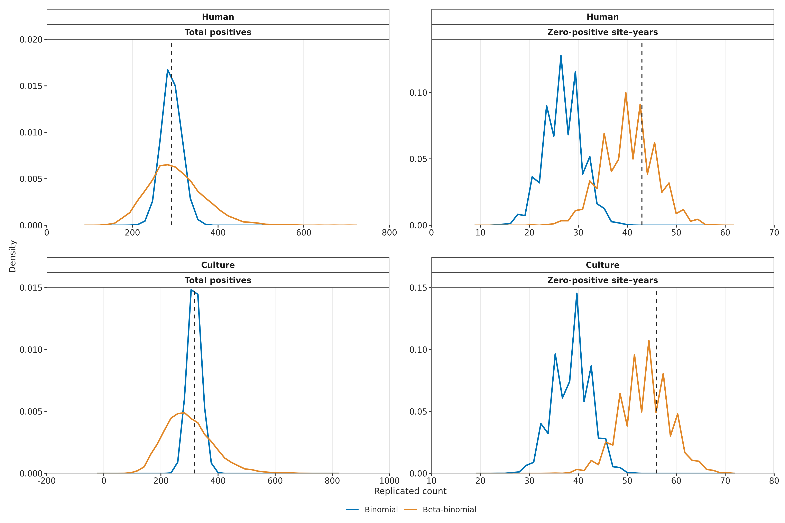
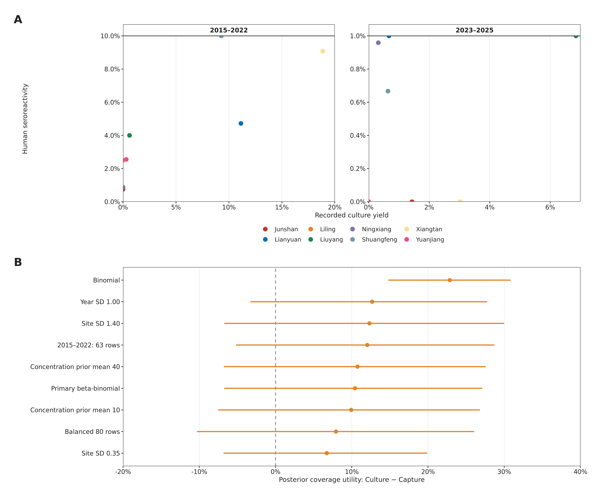

  <h3 style="font-family: inherit; font-weight: normal; margin-bottom: 0;">Online supplemental material</h3>
  <h1 style="font-family: inherit; font-weight: bold; font-size: 1.5em;">Rodent kidney culture versus capture yield for leptospirosis sentinel-site prioritisation in Hunan, China: historical coverage and decision uncertainty</h1>
   
   
  <i>Ziyan Liu, Kangguo Li, Zheni Bu, Zhihui Dai, Ziqi Yang, Mingxia Xiao, Jia Rui, Tianmu Chen, and Kaiwei Luo</i>

[TOC]

## 1. Supplementary Methods

### Analytical framework

The supplementary analyses distinguish four components of sentinel-site prioritisation: concordance between pooled surveillance indicators, historical coverage of human seropositive results, posterior uncertainty in site rankings, and the utility of fixed three-site portfolios (Table S22). The primary dataset comprises 87 jointly observed site–years from eight Hunan sentinel sites during 2015–2025.

Historical coverage is evaluated by leave-one-year-out (LOYO) selection using animal observations from the remaining years. Because those observations can precede or follow the omitted year, this analysis estimates representation within the historical series. Posterior ranking analyses quantify uncertainty under separate human and culture models. Decision utility evaluates two fixed animal-selected portfolios against year-standardised human rates, conditional on observed testing volumes. These quantities have different targets and conditioning assumptions; neither historical coverage nor posterior utility estimates prospective clinical benefit.

---

### S1. Data sources, analytical population, and surveillance indicators

Human microscopic agglutination test (MAT) serology, rodent kidney culture, and trapping records were linked by sentinel site and calendar year. Inclusion required recorded human positive and tested counts, culture-positive and effective-culture counts, and capture counts with trapping effort. The resulting joint panel contained 87 site–years, with totals of 291 seropositive results among 8,834 human tests, 317 culture-positive isolates among 6,824 effective cultures, and 7,333 captures over 270,469 trap-nights (Table S2). Surveillance records were supplied as provincial aggregate ledgers; published Hunan epidemiology provides background rather than the complete source of these 2015–2025 counts [1]. The national surveillance framework and the limits of procedural verification are described in Section S8. Reporting was guided by COHERE and STROBE [2,3]. Environmental measurements required for a complete COHERE report were not available.

The panel includes all eight sites in each year except 2018, when Yuanjiang had no rodent surveillance. Its human record (1/100) contributes to the provincial annual total of 39/803 but is excluded from the joint panel, whose 2018 total is 38/703. The 2020 human total of 24/805 is fully represented. Unmonitored animal outcomes were not assigned zero values. The previously ambiguous 2015 culture record with 0 positives among 99 effective cultures was identified as Ningxiang during the source audit. Inclusion decisions are summarised in Table S23. A balanced sensitivity analysis excluded 2018, leaving 80 site–years.

For each site, pooled human seroreactivity was the sum of positive results divided by the sum of tests; kidney-culture positivity was the sum of recorded positive isolates divided by the sum of effective cultures; and capture yield was the sum of captured rodents divided by the sum of trap-nights. Thus, pooled rates were ratios of counts rather than unweighted averages of annual percentages. Species composition was used descriptively and was not included as a model covariate.

Culture positivity was defined consistently across all study years. The printed 2023–2025 percentages of 1.92%, 11.11%, and 4.91% used submitted-culture denominators of 104, 117, and 224, respectively. The analysis used the same positive counts with the recorded effective-culture denominators: 2/606, 13/628, and 11/603. In four site–years, recorded effective cultures differed from total inoculated cultures minus contaminated tubes (Table S21). Recorded denominators were retained in the primary analysis; the arithmetic alternative was examined separately (Section S5). Aggregate records cannot establish which denominator better represents specimen-level evaluability, and agreement between analyses does not establish unbiased selection for culture.

Cultured positives per trap-night was examined as a compound indicator of isolate recovery relative to trapping effort. It combines annual counts from separate surveillance records; individual capture-to-culture linkage, reasons for culture selection, and laboratory recovery probabilities were unavailable. It therefore cannot be interpreted as an independently validated measure of infected-rodent density. Likewise, MAT seroreactivity among healthy residents is an exposure marker rather than contemporaneous clinical incidence. Provincial clinical notifications lacked site-level resolution, and environmental measurements and local operational costs were unavailable.

---

### S2. Rank concordance and historical site-selection performance

#### S2.1. Pooled concordance and site influence

Spearman rank correlations were calculated across the eight pooled site rates, assigning average ranks to ties. Exact two-sided probabilities were the proportion of all $8! = 40,320$ site-label permutations with absolute correlation at least as large as observed. Human–culture concordance was the primary comparison; human–capture and culture–capture concordance were descriptive comparisons. Each site was then omitted in turn, and the correlations and exact tests were repeated across the seven remaining sites ($7! = 5,040$ permutations; Table S3). These analyses assess association between site rankings and sensitivity to individual sites.

#### S2.2. Leave-one-year-out selection

In each leave-one-year-out (LOYO) fold, candidate three-site portfolios ($k = 3$) were selected by ranking eligible sites on ratios of animal counts pooled across all other observed years. Eligibility was restricted to sites monitored in the omitted year, giving seven eligible sites in 2018 and eight in other years. When a selection boundary was tied, all admissible portfolios were weighted equally; the primary three-site selections were untied. Human outcomes were used only to evaluate the selected portfolios in the omitted year (Table S4).

Within each fold $t$, let $Y_{st}$ and $N_{st}$ denote observed human seropositive counts and human tests at site $s$, and let $I_{st}^{(r)} \in \{0, 1\}$ indicate whether site $s$ was selected under animal rule $r \in \{\text{culture}, \text{capture}, \text{compound}\}$. For the untied primary selections, sums extend only over observed site–year cells. Primary summaries pool counts across the 11 folds prior to calculating positive coverage ($C$), testing share ($S$), and detection enrichment ($E = C / S$):

$$C_r = \frac{\sum_{t=1}^{11}\sum_{s} I_{st}^{(r)} Y_{st}}{\sum_{t=1}^{11}\sum_{s} Y_{st}}, \quad S_r = \frac{\sum_{t=1}^{11}\sum_{s} I_{st}^{(r)} N_{st}}{\sum_{t=1}^{11}\sum_{s} N_{st}}, \quad E_r = \frac{C_r}{S_r}$$

Pooled LOYO performance metrics across the three rules are reported in Table S4. For coverage, pooling counts weights each year in proportion to its observed number of human positives, whereas averaging annual coverage fractions would give years equal weight: 2015–2017 contributed $199 / 291$ ($68.4\%$) of all human seropositives. In those three folds, culture selection covered $146 / 199$ human positives and capture selection covered $96 / 199$. In 2023–2025, within the same full-panel evaluation, each rule covered $5 / 11$ positives (Table S6, Table S19).

The compound rule (cultured positives per trap-night) selected the exact same three-site portfolio as culture positivity in every fold and therefore does not independently replicate the culture rule. Culture selection returned $\{\text{Lianyuan, Shuangfeng, Xiangtan}\}$ in all 11 folds; because that set was invariant to omitting any single year, culture's pooled LOYO coverage equals the in-sample coverage of the full-period culture ranking ($202 / 291$, $69.4\%$). Capture selection returned $\{\text{Liuyang, Shuangfeng, Yuanjiang}\}$ in all ten folds in which Yuanjiang was eligible. In 2018, when Yuanjiang was unavailable, Lianyuan entered the capture portfolio. That single-year substitution explains why the fixed full-period capture trio covers $135 / 291$ ($46.4\%$) of human positives—four fewer than the pooled LOYO capture total ($139 / 291$, $47.8\%$), corresponding to Lianyuan's four human positives in 2018 (Table S4, Table S25).

For fixed portfolios drawn uniformly from all eight sites, expected coverage is $3/8 = 37.5\%$. A random LOYO rule restricted to the eligible sites instead has expected coverage of $3/7$ in 2018 and $3/8$ otherwise, giving pooled expected coverage of $38.2\%$. These are combinatorial references; neither incorporates operational costs.

#### S2.3. Exact trajectory permutation

For the paired non-parametric comparison between rules ($\Delta E = E_{\text{culture}} - E_{\text{capture}}$ and $\Delta C = C_{\text{culture}} - C_{\text{capture}}$), each permutation assigns complete multi-year human positive and tested trajectories to animal-site labels while preserving the exact observation pattern. Because Yuanjiang's 10-year trajectory cannot be exchanged with the seven complete 11-year trajectories, the exact reference distribution comprises $7! = 5,040$ assignments (compared with $8! = 40,320$ when 2018 is dropped in the balanced panel). Animal-selected portfolios remain fixed, and the same trajectory assignment is applied across all years and both rules. Two-sided exact $P$ values evaluate $|\Delta - \text{median}_{\text{null}}(\Delta)|$ (including ties within $10^{-12}$). Because Yuanjiang is unexchanged, the null median of $\Delta E$ is $0.173$ (not zero), with a central $95\%$ null reference range of $-0.680$ to $0.950$; the observed $\Delta E = 0.519$ yields a two-sided exact $P = 0.505$. For $\Delta C$, the observed difference of $0.216$ yields a two-sided exact $P = 0.471$ (null median $0.065$; central $95\%$ null reference range $-0.258$ to $0.375$). These intervals describe the null permutation distribution rather than confidence intervals for the observed differences. Statistical exactness is conditional on trajectory exchangeability within the observation pattern; preserving trajectories retains within-site temporal autocorrelation while animal-only selection prevents direct circularity on the human evaluation outcome.

---

### S3. Bayesian models and posterior site rankings

For each surveillance stream $d \in \{\text{human}, \text{culture}\}$ separately, an observed positive count $y_{dst}$ at site $s \in \{1, \dots, 8\}$ and year $t \in \{1, \dots, 11\}$ with denominator $n_{dst}$ is modelled using a beta-binomial likelihood with mean probability $\mu_{dst} \in (0, 1)$ and stream-specific concentration $\phi_d > 0$:

$$y_{dst} \mid n_{dst}, \mu_{dst}, \phi_d \sim \text{BetaBinomial}\!\left(n_{dst},\, \mu_{dst}\phi_d,\, (1 - \mu_{dst})\phi_d\right)$$

which has mean $\mathbb{E}(y_{dst}) = n_{dst}\mu_{dst}$ and variance:

$$\text{Var}(y_{dst}) = n_{dst}\mu_{dst}(1 - \mu_{dst})\frac{n_{dst} + \phi_d}{1 + \phi_d}$$

The linear predictor on the logit scale is an intercept plus additive site and year contrasts:

$$\text{logit}(\mu_{dst}) = \alpha_d + a_{ds} + b_{dt}$$

Site and year effects were represented by orthonormal contrasts with exact sum-to-zero constraints. Independent contrast coefficients followed $\mathcal{N}(0,\tau^2)$ priors, inducing covariance $\tau^2(\mathbf I_M-\mathbf 1_M\mathbf 1_M^\top/M)$ on the $M$ effects. Accordingly, $\tau$ is a contrast-coefficient prior scale; the marginal site-effect standard deviation is $\tau_{\mathrm{site}}\sqrt{7/8}$. In the primary fits, prior scales were set to $\tau_{\text{site}} = 0.70$ and $\tau_{\text{year}} = 0.50$, stream intercept priors were $\alpha_{\text{human}} \sim \mathcal{N}(-3.4, 2^2)$ and $\alpha_{\text{culture}} \sim \mathcal{N}(-3.0, 2^2)$, and the beta-binomial concentration prior was $\phi_d \sim \text{Gamma}(\text{shape} = 2, \text{rate} = 0.1)$ (prior mean $20$). These prior scales were fixed rather than estimated through hyperpriors. Parallel standard binomial models replaced the likelihood with $y_{dst} \sim \text{Binomial}(n_{dst}, \mu_{dst})$ under identical mean-structure priors.

Year-standardised rates are defined for each posterior draw $m \in \{1, \dots, 6000\}$ as the equal-weight average of the inverse-logit conditional mean predictions across all 11 calendar years (2015–2025):

$$p_{ds}^{(m)} = \frac{1}{11}\sum_{t=1}^{11}\text{logit}^{-1}\!\left(\alpha_d^{(m)} + a_{ds}^{(m)} + b_{dt}^{(m)}\right)$$

For every site and year—observed or unmonitored—the summand is the inverse logit of the linear predictor (a conditional expectation, not an observed proportion or a posterior predictive count draw). For Yuanjiang in 2018, the summand uses the intercept, Yuanjiang's site effect, and the 2018 year effect estimated from the seven monitored sites. Because the inverse-logit function is strictly increasing and $\alpha_d^{(m)} + b_{dt}^{(m)}$ is shared across all sites within year $t$, $p_{ds}^{(m)}$ preserves the exact within-draw site rank order of the site effects $a_{ds}^{(m)}$ while supplying probability-scale rates for portfolio utility calculations.

Within each posterior draw, sites were ranked from highest ($1$) to lowest ($8$) standardised rate. Year-standardised beta-binomial rates and marginal top-three probabilities are reported in Table S11. Human and culture models were fitted independently. Pairing their draws in chain-then-draw order approximated the product of the two marginal posterior distributions ($6,000$ paired draws), from which Spearman $\rho$, site-specific joint top-three inclusion, and agreement of the complete top-three sets were calculated (Table S12, Table S24). Cross-stream covariance was not estimated. Posterior summaries were based on Markov chain Monte Carlo (MCMC) draws. Capture yield was treated as an empirical comparator without a separate sampling model.

---

### S4. Computation, convergence, and posterior predictive assessment

All Bayesian models were fitted using the No-U-Turn Sampler (NUTS) in PyMC (v5.28.5) [4] with the nutpie backend (v0.16.11) across four Markov chains and a target acceptance probability of $0.95$. Each primary model retained $1,500$ post-warmup draws per chain after $1,500$ tuning draws ($6,000$ retained draws). Each temporal-window, denominator-sensitivity, and prior-sensitivity model retained $1,000$ draws per chain after $1,000$ tuning draws ($4,000$ retained draws). Convergence diagnostics were evaluated in ArviZ (v0.23.4).

Across all $14$ stored model fits (Table S16), zero divergent transitions occurred, the maximum rank-normalised split-$\widehat{R}$ was $1.004$, the minimum bulk effective sample size (ESS) was $2,415$ (2015–2022 human fit), and the minimum tail ESS was $2,280$ (balanced-panel human fit) [5]. Under the primary beta-binomial models, posterior median concentration parameters $\phi_d$ were $15.4$ ($95\%$ CrI: $8.4\text{--}26.8$) for human serology and $6.7$ ($95\%$ CrI: $3.5\text{--}11.9$) for rodent kidney culture.

Posterior predictive assessment used replicated counts at the observed site–year denominators, with one replicated dataset per retained posterior draw. For beta-binomial models, cell probabilities $p_{dst}^{\text{rep}}$ were first drawn from $\text{Beta}(\mu_{dst}^{(m)}\phi_d^{(m)}, (1 - \mu_{dst}^{(m)})\phi_d^{(m)})$, followed by count draws $y_{dst}^{\text{rep}} \sim \text{Binomial}(n_{dst}, p_{dst}^{\text{rep}})$. Model fit was evaluated against observed zero-count cells, aggregate positive totals, pointwise $95\%$ predictive interval coverage (Table S10), and a descriptive binomial-scale Pearson discrepancy:

$$D(\mathbf{y}) = \sum_{s,t} \frac{(y_{dst} - n_{dst}\bar{\mu}_{dst})^2}{n_{dst}\bar{\mu}_{dst}(1 - \bar{\mu}_{dst}) + 10^{-12}}$$

where $\bar{\mu}_{dst}$ denotes the posterior mean cell probability and $10^{-12}$ is a numerical stabiliser. The same posterior-mean reference was used for observed and replicated discrepancies (Table S10, Figure S1). For the beta-binomial model, this statistic serves as a descriptive discrepancy on the nominal binomial variance scale rather than a variance-standardised goodness-of-fit test, and tail fractions comparing replicated versus observed discrepancies do not represent calibrated frequentist $P$ values. The observed numbers of zero-positive cells fell within the central 95% beta-binomial predictive intervals but above the corresponding binomial intervals. Pointwise intervals included 85 of 87 human cells and all 87 culture cells under the beta-binomial model. These checks supported its use as the primary likelihood; they assess compatibility with the fitted data rather than external calibration. The binomial models were retained to assess sensitivity to the likelihood.

---

### S5. Sensitivity to observation period and culture denominators

Five analyses assessed dependence on panel composition and denominator definitions (Table S17). Excluding 2018 produced a balanced panel of 80 site–years, with identical observation patterns at all eight sites. Under trajectory exchangeability, this permits $8! = 40,320$ assignments. In this panel, the enrichment contrast was 0.534 (two-sided $P=0.338$; central 95% null reference interval, $-0.968$ to 0.968), and the coverage contrast was 22.1 percentage points ($P=0.314$; null reference interval, $-37.9$ to 37.9 percentage points). Both permutation medians were zero.

Restricting analysis to 2015–2022 retained 63 site–years and the 2018 observation gap; Yuanjiang's trajectory therefore remained fixed in permutation tests. Two further descriptive analyses excluded the highest-burden year, 2015 (79 site–years), or used only 2023–2025 (24 site–years). Concordance and LOYO selection were recalculated within each observation window. Human and culture beta-binomial models were refitted for the balanced panel and the 2015–2022 window; no Bayesian refits were undertaken for the exclusion of 2015 or the recent three-year window.

For posterior utility in the two refitted windows, the culture- and capture-selected trios remained those determined from the primary 2015–2025 animal data. Human standardisation averaged over the years retained in each fit, and site weights were recalculated from human testing totals in that window. This fixed-portfolio comparison differs from the window-specific LOYO analyses, which reselect sites within each fold. The portfolio maximising posterior mean utility was also identified separately in each window.

The denominator sensitivity analysis replaced effective-culture counts with total cultures minus contaminated tubes, altering four site–years (Table S21). Descriptive analyses were repeated and the culture beta-binomial model was refitted; the human model was unchanged. For cross-stream posterior correlations, its 4,000 draws were paired with the first 4,000 retained primary human draws. The posterior probabilities of positive human–culture rank correlation were 0.981 for the balanced panel, 0.996 for 2015–2022, and 0.993 for the arithmetic denominator definition.

#### S5.1. Temporal decomposition and within-period reselection

Exploratory analyses compared 2015–2017 with 2018–2025 and examined 2023–2025 separately (Table S19). Period boundaries were selected during review of the observed series. First, held-out observed counts from the full-panel LOYO analysis were partitioned by period while retaining the original selections. Second, LOYO selection was repeated within each period, using only the other years in that period. Neither analysis imposed a forward temporal ordering.

In the full-panel decomposition, 2015–2017 accounted for 50 of the 63 additional positives covered by culture selection (79.4%); 2018–2025 accounted for the remaining 13, with no net difference in 2023–2025. Within-period reselection reduced the 2018–2025 contrast to one positive result (54/92 versus 53/92; 1.1 percentage points). Enrichment was 1.50 for culture and 1.54 for capture because the latter selected a smaller share of human tests. For 2015–2017, capture selection covered 97/199 positives after within-period reselection, compared with 96/199 under the full-panel selections. In 2023–2025, the corresponding within-period coverage was 4/11 versus 0/11 (enrichment permutation $P=0.187$); the small number of positives limits conclusions about late-period performance.

---

### S6. Portfolio coverage, posterior utility, and decision uncertainty

All $\binom{8}{k}$ site combinations for network sizes $k = 1$ to $7$ were enumerated from pooled observed counts (Table S7 records all $56$ three-site sets; Table S9 records all $254$ non-empty proper subsets). Across all combinations of size $k$, the mean observed positive coverage equals the uniform-random expectation $k / 8$. Because the empirical "best observed fixed set" uses the same pooled human counts to both select and score a portfolio, its coverage represents an in-sample upper bound for the observed series.

Arithmetic decompositions of the $+63$ held-out positive difference ($202 - 139$) in the primary LOYO evaluation by site and by year—computed as $(I_{st}^{\text{culture}} - I_{st}^{\text{capture}})Y_{st}$—are reported in Table S5 and Table S6. Spatially, the net difference reflects Xiangtan ($+79$) and Lianyuan ($+37$) against Liuyang ($-35$) and Yuanjiang ($-18$).

Pooled animal rates were untied at every boundary $k = 1$ to $7$ (Table S8). Culture ranking covered more human positives for $k = 1$ to $4$ and matched the in-sample optimal trio at $k = 3$ ($69.4\%$). Capture ranking covered more human positives for $k = 5$ to $7$: at $k = 5$, capture ranking added Xiangtan ($87.6\%$) whereas culture ranking added Junshan ($83.5\%$); at $k = 6$, coverages were $91.1\%$ versus $89.7\%$; and at $k = 7$, coverages were $97.9\%$ versus $93.1\%$ (Figure 3B).

#### S6.1. Posterior utility and regret

For each human posterior draw $m$ and fixed three-site portfolio $A$, coverage utility weights the year-standardised human rates $p_s^{(m)} \equiv p_{\text{human},s}^{(m)}$ by the observed site testing volumes $n_s$ ($1,006$ at Yuanjiang and $1,100\text{--}1,210$ at the other seven sites):

$$U^{(m)}(A) = \frac{\sum_{s \in A} n_s p_s^{(m)}}{\sum_{s=1}^{8} n_s p_s^{(m)}}$$

The candidate portfolios $A_{\text{culture}} = \{\text{Lianyuan, Shuangfeng, Xiangtan}\}$ and $A_{\text{capture}} = \{\text{Yuanjiang, Liuyang, Shuangfeng}\}$ remain fixed at the rankings derived from the pooled animal ledgers and are not re-selected within posterior draws. Utility conditions on these observed animal selections and testing volumes, without propagating animal-selection uncertainty or including operational costs. Draw-wise decision regret relative to the optimal trio among all $56$ candidates in draw $m$ is defined as:

$$R^{(m)}(A) = \max_{A' \in \mathcal{A}_{56}} U^{(m)}(A') - U^{(m)}(A)$$

Under the primary beta-binomial model (Table S13), $A_{\text{culture}}$ achieved a posterior mean utility of $0.552$ ($55.2\%$) and expected regret of $0.034$, whereas $A_{\text{capture}}$ achieved a mean utility of $0.448$ ($44.8\%$) and expected regret of $0.139$. Averaging uniformly over the $56$ trios yields a conditional expected utility of $0.375$ in every draw, expected regret of $0.211$, and a $1 / 56$ probability of being the draw-wise best set. The constant random-strategy utility is the expectation over portfolio selection within each draw, not the distribution of utility for a single randomly chosen trio. By linearity of expectation, expected regret satisfies $\mathbb{E}[R(A_{\text{capture}}) - R(A_{\text{culture}})] = \mathbb{E}[U(A_{\text{culture}}) - U(A_{\text{capture}})]$.

Writing $D$ for the observed surveillance data, within-draw paired utility differences $\Delta U^{(m)} = U^{(m)}(A_{\text{culture}}) - U^{(m)}(A_{\text{capture}})$ averaged $0.104$ ($10.4$ percentage points; $95\%$ CrI: $-0.067$ to $0.271$; Table S14). Across the $6,000$ draws, $5,311$ exceeded zero ($\Pr(\Delta U > 0 \mid D) = 88.5\%$), $3,138$ exceeded $0.10$ ($\Pr(\Delta U > 0.10 \mid D) = 52.3\%$), and $1,797$ exceeded $0.15$ ($\Pr(\Delta U > 0.15 \mid D) = 30.0\%$; Table S20). These probabilities apply to latent fixed-portfolio utility rather than the observed LOYO coverage difference. Posterior optimality among the $56$ sets had probability $33.4\%$ of draws for $A_{\text{culture}}$ versus $0.7\%$ for $A_{\text{capture}}$. A methodological comparison of LOYO coverage, full-period in-sample coverage, and posterior mean utility is presented in Table S25.

#### S6.2. Prior sensitivity

Five additional human beta-binomial fits perturbed one prior hyperparameter at a time around the primary specification ($\alpha_{\text{human}} \sim \mathcal{N}(-3.4, 2^2)$, $\tau_{\text{site}} = 0.70$, $\tau_{\text{year}} = 0.50$, $\phi \sim \text{Gamma}(2, 0.1)$ with mean $20$): setting $\tau_{\text{site}} \in \{0.35, 1.40\}$, setting $\tau_{\text{year}} = 1.00$, and setting $\phi \sim \text{Gamma}(2, 0.2)$ (prior mean $10$) or $\phi \sim \text{Gamma}(2, 0.05)$ (prior mean $40$). Because fixed animal-ranked portfolios do not depend on the human prior, only the human model was refitted (Table S18, Figure S2B). Across all five prior refits, every $95\%$ credible interval for $\Delta U$ included zero (posterior means $6.7$ to $12.7$ percentage points; $\Pr(\Delta U > 0)$ between $84.4\%$ and $94.3\%$), and the posterior-mean optimal trio remained $\{\text{Lianyuan, Shuangfeng, Xiangtan}\}$.

#### S6.3. Likelihood sensitivity

Table S15 compares the two primary human likelihoods, each using $6,000$ retained draws and identical mean-structure priors. Both likelihoods identify $\{\text{Lianyuan, Shuangfeng, Xiangtan}\}$ as the posterior-mean optimum. The binomial specification yielded a larger mean difference of $22.9$ percentage points ($95\%$ CrI: $14.8\text{--}30.8$), compared with $10.4$ percentage points under the beta-binomial model. All $6,000$ binomial draws favoured culture, compared with $88.5\%$ of beta-binomial draws.

#### S6.4. Conditional design simulation

A conditional Monte Carlo simulation fixed the human and culture denominators pooled across 2015–2025 at each site. For stream $d$, the intercept was the logit of the observed network-wide pooled proportion. Bivariate normal site effects had marginal standard deviation 0.70 and correlation $\rho_{\mathrm{latent}}\in\{0,0.4,0.8\}$. Applying the inverse-logit transformation gave site probabilities from which independent binomial counts were simulated. No year effects or extra-binomial variation were included.

Each scenario comprised 1,500 replicated datasets. A common sample of 999 site-label permutations was generated once and used to test the pooled Spearman correlation in each replicate. The two-sided Monte Carlo probability was $(1+b)/1,000$, where $b$ counts permuted absolute correlations at least as large as the observed absolute correlation, allowing a numerical tolerance of $10^{-12}$. Rejection proportions at $P\le0.05$ were 5.7%, 11.6%, and 48.5% for the three scenarios (Table S1). These results characterise power under the specified binomial assumptions; they do not estimate power for the LOYO trajectory test or reproduce the dispersion in the primary beta-binomial models.

#### S6.5. Illustrative cost thresholds

Benefit thresholds of 10 and 15 percentage points were exploratory and were not prespecified minimum worthwhile gains. A symbolic cost comparison was used because local costs and monetary valuations were unavailable (Table S20). Let $K_A$ denote the total cost of operating strategy $A$ over a planning horizon (including animal sampling at candidate sites and operating selected sites), and let $B > 0$ denote the programme's monetary valuation of a unit increase in coverage utility from $0$ to $1$. Under a linear net-value function:

$$V^{(m)}(A) = B \cdot U^{(m)}(A) - K_A$$

writing the incremental cost of culture as $\Delta K = K_{\text{culture}} - K_{\text{capture}}$ and the normalised cost penalty in coverage-utility units as $\lambda = \Delta K / B$, positive incremental net value for culture relative to capture requires $\Delta U^{(m)} > \lambda$, so that $\Pr(\Delta V > 0 \mid D, B, \Delta K) = \Pr(\Delta U > \lambda \mid D)$. Under posterior-mean net value maximisation, the break-even incremental cost is $\Delta K^* = B \cdot \mathbb{E}(\Delta U \mid D) \approx 0.1043 B$. Thus, a cost penalty above $0.1043$ coverage-utility units reverses the preference based on posterior mean net value. This threshold is relative to the assumed valuation $B$, not to the programme budget. This calculation holds costs deterministic and does not value isolate recovery or prevented clinical cases.

---

### S7. Reproducibility and availability of analytical materials

The analysis used audited site–year counts, exact enumeration for permutation tests, and saved posterior draws for Bayesian summaries. Counts and extended tabulations accompany the relevant supplementary tables. Software versions and sampling settings are reported in Section S4, and random seeds are listed in Table S26. The 14 model fits comprise four primary fits, five human prior-sensitivity fits, four temporal-window fits, and one culture-denominator fit. Period decompositions and utility-threshold calculations use existing counts and posterior draws without additional model fitting.

Scripts, the released aggregated site–year counts, posterior summaries, and the outputs that reproduce this analysis are publicly available at [https://github.com/xmusphlkg/leptospirosis_hunan](https://github.com/xmusphlkg/leptospirosis_hunan). Binary NetCDF posterior draws are not included; the analysis code can regenerate them from the released panel. Source surveillance workbooks and individual-level records are not in the public release.

---

### S8. Surveillance protocol and limits of procedural verification

The national protocol specifies pre-epidemic collection of 100 serum samples per site, with 20 from each of five age groups (10–19, 20–29, 30–39, 40–49, and $\ge 50$ years). Its MAT procedure uses 15 reference strains and a 50% agglutination endpoint [6,7]. Human counts were analysed as classified in the provincial summaries. The MAT positivity threshold of $\ge 1{:}50$ described in the main text is the reported surveillance definition; individual titres were unavailable for independent reclassification.

For animal kidney isolation, the protocol specifies aseptic inoculation of fresh kidney tissue into Korthof medium, incubation at $28^\circ\mathrm{C}$, and dark-field examination every 5–7 days, with continued incubation to 60 days before a negative result. It also specifies subsequent grouping and typing of isolates [6]. These procedures describe the surveillance framework, whereas the available site–year tables record aggregate counts. They do not verify adherence at every site and sampling occasion. Culture recovery is also subject to the diagnostic limitations discussed in the literature [8].

Trapping records distinguish first- and second-half-year surveys, while culture records lack collection months. Annual aggregation therefore cannot establish whether either animal indicator preceded the human sampling period or whether sampling occurred in the same villages. Sampling dates, eligibility criteria, specimen selection, and serovar-specific results could not be independently verified across all site–years from these aggregate records.

---

## 2. Supplementary Tables

Tables S1–S26 report supplementary methods and results. Linked data tables provide site–year observations, posterior summaries, and complete portfolio enumerations. CrI denotes an equal-tailed credible interval; PI denotes a posterior predictive interval. Probabilities reported as 0.000 or 1.000 are rounded Monte Carlo estimates.

**Table S1. Conditional design simulation for the pooled rank-correlation test.**

| Latent correlation | Replicates | Rejections at $P \le 0.05$ | Rejection proportion (%) |
| --- | --- | --- | --- |
| 0.0 | 1500 | 85 | 5.7 |
| 0.4 | 1500 | 174 | 11.6 |
| 0.8 | 1500 | 728 | 48.5 |

[Supplementary data](tables/table_s1_design_simulation.csv). Each replicate used 999 sampled label permutations; assumptions are defined in Section S6.4.

---

**Table S2. Complete audited surveillance ledger containing human seropositive/tested counts, rodent kidney-culture positive/effective counts, and rodent captured/trap-night counts across the $87$ joint site–years (excluding the unlinked 2018 Yuanjiang human record).**

[Supplementary data](tables/table_s2_site_year_counts.csv).

**Table S3. Sensitivity of pooled rank concordance to omission of individual sites.**

| Omitted site | Human–culture $\rho$ | Exact $P$ | Human–capture $\rho$ | Exact $P$ |
| --- | --- | --- | --- | --- |
| None (eight sites) | 0.714 | 0.0576 | 0.429 | 0.2992 |
| Junshan | 0.786 | 0.0480 | 0.143 | 0.7825 |
| Lianyuan | 0.643 | 0.1389 | 0.464 | 0.3024 |
| Liling | 0.786 | 0.0480 | 0.393 | 0.3956 |
| Liuyang | 0.571 | 0.2000 | 0.536 | 0.2357 |
| Ningxiang | 0.750 | 0.0663 | 0.214 | 0.6615 |
| Shuangfeng | 0.679 | 0.1095 | 0.429 | 0.3536 |
| Xiangtan | 0.643 | 0.1389 | 0.464 | 0.3024 |
| Yuanjiang | 0.750 | 0.0663 | 0.714 | 0.0881 |

[Supplementary data](tables/table_s3_leave_one_site_out.csv). The full panel uses 40,320 label permutations; each seven-site analysis uses 5,040.

---

**Table S4. Pooled leave-one-year-out (LOYO) historical coverage, testing share, and detection enrichment across 11 folds (2015–2025; fold-by-fold annual selections provided in CSV file).**

[Supplementary data](tables/table_s4_historical_evaluation.csv).

| Animal Selection Rule | Held-Out Human Positives Covered | Human Tests Covered | Pooled Coverage ($C$) | Pooled Testing Share ($S$) | Detection Enrichment ($E = C / S$) |
| --- | --- | --- | --- | --- | --- |
| Capture yield | $139 / 291$ | $3,306 / 8,834$ | $0.4777$ | $0.3742$ | $1.2764$ |
| Culture positivity | $202 / 291$ | $3,415 / 8,834$ | $0.6942$ | $0.3866$ | $1.7957$ |
| Cultured positives per trap-night | $202 / 291$ | $3,415 / 8,834$ | $0.6942$ | $0.3866$ | $1.7957$ |

---

**Table S5. Site contributions to the difference in observed human positives covered by LOYO selection.**

| Site | Observed human positives | Culture minus capture coverage (count) |
| --- | --- | --- |
| Junshan | 6 | 0 |
| Lianyuan | 41 | +37 |
| Liling | 20 | 0 |
| Liuyang | 35 | -35 |
| Ningxiang | 10 | 0 |
| Shuangfeng | 82 | 0 |
| Xiangtan | 79 | +79 |
| Yuanjiang | 18 | -18 |
| Total | 291 | +63 |

[Supplementary data](tables/table_s5_site_contributions.csv). Contributions retain the full-panel LOYO selections and sum to 63.

---

**Table S6. Year contributions to the difference in observed human positives covered by LOYO selection.**

| Year | Observed human positives | Culture minus capture coverage (count) |
| --- | --- | --- |
| 2015 | 96 | +10 |
| 2016 | 69 | +31 |
| 2017 | 34 | +9 |
| 2018 | 38 | +7 |
| 2019 | 15 | -4 |
| 2020 | 24 | +11 |
| 2021 | 3 | -1 |
| 2022 | 1 | 0 |
| 2023 | 4 | +2 |
| 2024 | 1 | +1 |
| 2025 | 6 | -3 |
| Total | 291 | +63 |

[Supplementary data](tables/table_s6_year_contributions.csv). Contributions retain the full-panel LOYO selections and sum to 63.

---

**Table S7. Exhaustive enumeration of all $\binom{8}{3} = 56$ candidate three-site portfolios scored on pooled 2015–2025 counts.**

[Supplementary data](tables/table_s7_all_portfolios.csv).

**Table S8. Observed human-positive coverage by fixed portfolio size.**

| Sites selected | Culture (%) | Capture (%) | Observed optimum (%) | Uniform random (%) |
| --- | --- | --- | --- | --- |
| 1 | 27.1 | 6.2 | 28.2 | 12.5 |
| 2 | 41.2 | 18.2 | 55.3 | 25.0 |
| 3 | 69.4 | 46.4 | 69.4 | 37.5 |
| 4 | 81.4 | 60.5 | 81.4 | 50.0 |
| 5 | 83.5 | 87.6 | 88.3 | 62.5 |
| 6 | 89.7 | 91.1 | 94.5 | 75.0 |
| 7 | 93.1 | 97.9 | 97.9 | 87.5 |

[Supplementary data](tables/table_s8_portfolio_frontier.csv). The observed optimum is calculated from the complete enumeration in Table S9 and is an in-sample upper bound. Uniform random coverage is the mean over all equally sized subsets of the eight sites.

---

**Table S9. Complete enumeration and pooled performance of all $254$ non-empty proper site subsets for $k = 1$ to $7$.**

[Supplementary data](tables/table_s9_all_portfolios_k1_k7.csv).

---

**Table S10. Posterior predictive assessment across the 87 observed site–years.**

[Beta-binomial cell-level predictive intervals](tables/table_s10_predictive_cells.csv) and [model-level predictive summaries](tables/table_s10_predictive_summary.csv). Central intervals use the 2.5th and 97.5th empirical percentiles with linear interpolation; count endpoints below are rounded to the nearest integer.

| Model / Surveillance Stream | Observed Zero Cells | Replicated Zero Cells (Central 95% PI) | Observed Total Positives | Replicated Total Positives (Central 95% PI) | Cells Inside Pointwise 95% PI | Descriptive Pearson Tail Fraction |
| --- | --- | --- | --- | --- | --- | --- |
| Binomial / Human | $43$ | $19\text{--}35$ | $291$ | $247\text{--}338$ | $81 / 87$ | $0.001$ |
| Binomial / Culture | $56$ | $31\text{--}46$ | $317$ | $272\text{--}362$ | $75 / 87$ | $<0.001$ |
| Beta-binomial / Human | $43$ | $30\text{--}51$ | $291$ | $191\text{--}444$ | $85 / 87$ | $0.887$ |
| Beta-binomial / Culture | $56$ | $44\text{--}63$ | $317$ | $157\text{--}489$ | $87 / 87$ | $0.825$ |

---

**Table S11. Year-standardised rates and marginal top-three inclusion under the primary beta-binomial models.**

| Site | Human rate, % (95% CrI) | Human top-three probability | Culture rate, % (95% CrI) | Culture top-three probability |
| --- | --- | --- | --- | --- |
| Shuangfeng | 5.58 (2.88–9.31) | 0.890 | 6.01 (2.95–10.98) | 0.977 |
| Xiangtan | 4.50 (2.25–7.80) | 0.691 | 10.96 (5.85–18.16) | 1.000 |
| Lianyuan | 4.30 (2.30–7.28) | 0.658 | 5.00 (2.19–9.83) | 0.908 |
| Liuyang | 4.20 (2.23–7.24) | 0.632 | 2.13 (0.77–5.17) | 0.084 |
| Liling | 2.18 (0.94–4.25) | 0.041 | 1.02 (0.32–2.81) | 0.004 |
| Yuanjiang | 2.38 (1.08–4.82) | 0.072 | 1.28 (0.43–3.37) | 0.010 |
| Ningxiang | 1.95 (0.89–3.80) | 0.015 | 1.15 (0.40–2.96) | 0.005 |
| Junshan | 1.23 (0.49–2.82) | 0.001 | 1.37 (0.45–3.52) | 0.014 |

[Supplementary data](tables/table_s11_beta_binomial_site_rates.csv). Rates are posterior medians. Each calendar year receives equal weight; top-three probabilities are marginal to each surveillance stream.

---

**Table S12. Site-specific joint posterior probabilities of simultaneous inclusion in the top three of both human seroreactivity and rodent kidney culture under the primary beta-binomial model.**

[Supplementary data](tables/table_s12_joint_priorities.csv).

| Sentinel Site | Beta-Binomial Joint Top-Three Inclusion Probability |
| --- | --- |
| Shuangfeng | $0.870$ |
| Xiangtan | $0.691$ |
| Lianyuan | $0.596$ |
| Liuyang | $0.054$ |
| Yuanjiang | $0.001$ |
| Ningxiang | $0.0002$ |
| Liling | $0.000$ |
| Junshan | $0.000$ |

*Footnote:* Site-specific joint probabilities need not sum to $3.0$. The probability that the complete three-site sets coincide simultaneously is $0.278$ under the beta-binomial model and $0.750$ under the binomial model (Table S24).

---

**Table S13. Posterior utility and expected regret for the primary three-site strategies.**

| Strategy | Mean utility (%) | 95% CrI (%) | Probability of optimality | Expected regret |
| --- | --- | --- | --- | --- |
| Culture | 55.2 | 43.7–66.2 | 0.334 | 0.034 |
| Capture | 44.8 | 33.8–55.9 | 0.007 | 0.139 |
| Posterior-mean optimum | 55.2 | 43.7–66.2 | 0.334 | 0.034 |
| Uniform random expectation | 37.5 | — | 0.018 | 0.211 |

[Supplementary data](tables/table_s13_posterior_decision_utility.csv). Optimality and regret are evaluated against all 56 trios. The posterior-mean optimum coincides with the culture-selected trio. The random-strategy entry averages utility across all portfolios within each posterior draw and is not a predictive interval for an individual random portfolio.

---

**Table S14. Paired culture-minus-capture posterior utility difference.**

| Posterior mean (percentage points) | 95% CrI (percentage points) | $\Pr(\Delta U>0)$ | Posterior draws |
| --- | --- | --- | --- |
| 10.4 | -6.7 to 27.1 | 0.885 | 6000 |

[Supplementary data](tables/table_s14_paired_posterior_utility.csv). Differences compare the same two fixed portfolios within each human posterior draw.

---

**Table S15. Sensitivity of portfolio decision utility and expected regret to likelihood specification (primary beta-binomial vs. standard binomial human fits; paired utility contrasts for all nine human fits in the linked data).**

[Paired utility contrasts](tables/table_s15_decision_model_sensitivity.csv) and [strategy-specific utility and regret](tables/table_s15_strategy_utility.csv).

| Posterior Decision Quantity | Beta-Binomial Likelihood (Primary) | Standard Binomial Likelihood (Comparison) |
| --- | --- | --- |
| Culture mean utility (95% CrI), % | $55.2$ ($43.7\text{--}66.2$) | $67.9$ ($62.6\text{--}72.9$) |
| Capture mean utility (95% CrI), % | $44.8$ ($33.8\text{--}55.9$) | $45.0$ ($39.8\text{--}50.2$) |
| Paired mean difference $\Delta U$ (95% CrI), percentage points | $10.4$ ($-6.7\text{ to }27.1$) | $22.9$ ($14.8\text{ to }30.8$) |
| Posterior probability $\Pr(U_{\text{culture}} > U_{\text{capture}})$ | $0.885$ | $1.000$ |
| Culture expected regret | $0.034$ | $0.004$ |
| Capture expected regret | $0.139$ | $0.232$ |
| Probability of optimality among 56 sets (Culture) | $0.334$ | $0.757$ |

---

**Table S16. MCMC sampling and convergence diagnostics for the four primary models (diagnostics for all 14 stored fits provided in CSV file; zero divergences across all fits, maximum $\widehat{R} = 1.004$, minimum bulk ESS $= 2,415$, minimum tail ESS $= 2,280$).**

[Supplementary data](tables/table_s16_nuts_laplace.csv).

| Model / Surveillance Stream | Divergent Transitions | Maximum $\widehat{R}$ | Minimum Bulk ESS | Minimum Tail ESS | Retained Draws |
| --- | --- | --- | --- | --- | --- |
| Binomial / Human | $0$ | $1.002$ | $4,679$ | $4,000$ | $6,000$ |
| Binomial / Culture | $0$ | $1.003$ | $2,417$ | $3,543$ | $6,000$ |
| Beta-binomial / Human (Primary) | $0$ | $1.002$ | $4,516$ | $4,091$ | $6,000$ |
| Beta-binomial / Culture (Primary) | $0$ | $1.002$ | $4,271$ | $4,097$ | $6,000$ |

---

**Table S17. Sensitivity to observation period and culture-denominator definition.**

[Posterior rank-correlation summaries](tables/table_s17_binomial_prior_sensitivity.csv). Observed concordance and LOYO selection were recalculated within each window; posterior utility retained the two primary animal-selected portfolios and used window-specific human rates and testing volumes. No new human model was needed for the arithmetic culture-denominator analysis.

**A. Observed concordance and historical coverage**

| Analysis | Site–years | Human–culture $\rho$ (exact $P$) | LOYO human positives: culture vs. capture | Enrichment $P$ |
| --- | --- | --- | --- | --- |
| Primary (2015–2025) | $87$ | $0.714$ ($0.0576$) | $202 / 291$ vs. $139 / 291$ | $0.505$ |
| Drop 2018 (Balanced) | $80$ | $0.762$ ($0.0368$) | $177 / 253$ vs. $121 / 253$ | $0.338$ |
| Years through 2022 | $63$ | $0.903$ ($0.0054$) | $197 / 280$ vs. $134 / 280$ | $0.488$ |
| Exclude 2015 | $79$ | $0.707$ ($0.0595$) | $126 / 195$ vs. $80 / 195$ | $0.246$ |
| 2023–2025 only | $24$ | $0.347$ ($0.3869$) | $4 / 11$ vs. $0 / 11$ | $0.187$ |
| Arithmetic effective cultures | $87$ | $0.714$ ($0.0576$) | $202 / 291$ vs. $139 / 291$ | $0.505$ |

**B. Posterior sensitivity summaries**

| Analysis | Mean $\Delta U$, percentage points (95% CrI; $\Pr(\Delta U>0)$) | Posterior $\Pr(\rho>0)$ | Posterior-mean optimal trio |
| --- | --- | --- | --- |
| Primary (2015–2025) | $10.4$ ($-6.7$ to $27.1$; $88.5\%$) | $0.992$ | Lianyuan, Shuangfeng, Xiangtan |
| Drop 2018 (Balanced) | $7.9$ ($-10.3$ to $26.0$; $80.2\%$) | $0.981$ | Lianyuan, Shuangfeng, Xiangtan |
| Years through 2022 | $12.0$ ($-5.2$ to $28.7$; $91.0\%$) | $0.996$ | Liuyang, Shuangfeng, Xiangtan |
| Exclude 2015 | Descriptive only | Not refitted | Not refitted |
| 2023–2025 only | Descriptive only | Not refitted | Not refitted |
| Arithmetic effective cultures | Culture model refitted | $0.993$ | Unchanged |

---

**Table S18. Posterior portfolio utility differences ($\Delta U$) across one-at-a-time human beta-binomial prior sensitivity refits.**

[Strategy-specific utility and regret](tables/table_s18_decision_prior_sensitivity.csv); [paired utility contrasts](tables/table_s15_decision_model_sensitivity.csv).

| Prior Specification | Mean $\Delta U$ (Percentage Points) | 95% Credible Interval | Posterior $\Pr(\text{Culture} > \text{Capture})$ |
| --- | --- | --- | --- |
| Primary: site coefficient SD $0.70$, year coefficient SD $0.50$, concentration mean $20$ | $10.4$ | $-6.7\text{ to }27.1$ | $0.885$ |
| Site coefficient SD $0.35$ | $6.7$ | $-6.8\text{ to }19.9$ | $0.844$ |
| Site coefficient SD $1.40$ | $12.3$ | $-6.7\text{ to }30.0$ | $0.898$ |
| Year coefficient SD $1.00$ | $12.7$ | $-3.3\text{ to }27.8$ | $0.943$ |
| Concentration prior mean $10$ ($\text{Gamma}(2, 0.2)$) | $9.9$ | $-7.5\text{ to }26.8$ | $0.869$ |
| Concentration prior mean $40$ ($\text{Gamma}(2, 0.05)$) | $10.7$ | $-6.8\text{ to }27.6$ | $0.893$ |

---

**Table S19. Exploratory sub-period decomposition of LOYO human positive coverage comparing full-panel folds against within-period reselection.**

[Period summaries](tables/table_s19_period_coverage.csv) and [fold-specific selections](tables/table_s19_period_selections.csv).

| Evaluation Scheme | Calendar Period | Human positives covered: culture (%) | Human positives covered: capture (%) | Coverage Difference (Percentage Points) | Enrichment (culture; capture) |
| --- | --- | --- | --- | --- | --- |
| Full-panel folds | 2015–2017 | $146 / 199$ ($73.4\%$) | $96 / 199$ ($48.2\%$) | $+25.1$ | $1.96\text{; }1.28$ |
| Full-panel folds | 2018–2025 | $56 / 92$ ($60.9\%$) | $43 / 92$ ($46.7\%$) | $+14.1$ | $1.56\text{; }1.25$ |
| Full-panel folds | 2018–2022 | $51 / 81$ ($63.0\%$) | $38 / 81$ ($46.9\%$) | $+16.0$ | $1.59\text{; }1.24$ |
| Full-panel folds | 2023–2025 | $5 / 11$ ($45.5\%$) | $5 / 11$ ($45.5\%$) | $0.0$ | $1.19\text{; }1.24$ |
| Within-period reselection | 2015–2017 | $146 / 199$ ($73.4\%$) | $97 / 199$ ($48.7\%$) | $+24.6$ | $1.96\text{; }1.30$ |
| Within-period reselection | 2018–2025 | $54 / 92$ ($58.7\%$) | $53 / 92$ ($57.6\%$) | $+1.1$ | $1.50\text{; }1.54$ |
| Within-period reselection | 2023–2025 | $4 / 11$ ($36.4\%$) | $0 / 11$ ($0.0\%$) | $+36.4$ | $0.95\text{; }0.00$ |

---

**Table S20. Posterior probabilities that paired utility difference ($\Delta U$) exceeds illustrative benefit thresholds and cost break-even penalties ($\lambda = \Delta K / B$).**

[Supplementary data](tables/table_s20_utility_thresholds.csv).

| Threshold / Assumed Cost Penalty in Coverage-Utility Units ($\lambda$) | Posterior Draws Exceeding Threshold (out of $6,000$) | Posterior Probability of Positive Incremental Net Value |
| --- | --- | --- |
| $0$ percentage points ($\lambda = 0.00$) | $5,311$ | $88.5\%$ |
| $10$ percentage points ($\lambda = 0.10$) | $3,138$ | $52.3\%$ |
| $15$ percentage points ($\lambda = 0.15$) | $1,797$ | $30.0\%$ |

---

**Table S21. Audit of the four site–years in which recorded effective cultures differ from total cultures minus contaminated tubes.**

[Supplementary data](tables/table_s21_culture_denominator_audit.csv).

| Site and Year | Culture-Positive Isolates | Recorded Effective Cultures (Primary) | Total Cultures Inoculated | Contaminated Tubes | Arithmetic Effective Cultures (Sensitivity) |
| --- | --- | --- | --- | --- | --- |
| Shuangfeng, 2016 | $15$ | $92$ | $116$ | $14$ | $102$ |
| Lianyuan, 2019 | $2$ | $37$ | $50$ | $0$ | $50$ |
| Liuyang, 2019 | $0$ | $52$ | $54$ | $3$ | $51$ |
| Xiangtan, 2025 | $1$ | $102$ | $102$ | $1$ | $101$ |

---

**Table S22. Overview of analytical estimands across the primary 87 site–year panel (2015–2025).**

| Estimand | Varying Quantity | Fixed / Conditioning Quantity | Primary Analytical Summary |
| --- | --- | --- | --- |
| Rank concordance | Site labels ($8! = 40,320$ permutations) | Pooled human, culture, and capture rates | Human–culture Spearman $\rho = 0.714$ (exact $P = 0.0576$); human–capture $\rho = 0.429$ ($P = 0.299$); culture–capture $\rho = 0.286$ ($P = 0.501$). |
| Posterior ranking | Human and culture rates under independent posterior distributions | Likelihood, priors, and equal weighting of calendar years | Probability of identical top-three sets: $0.278$ under the beta-binomial model and $0.750$ under the binomial model. |
| Historical coverage | Human trajectories within the observation pattern ($7! = 5,040$ permutations) | Animal-selected three-site sets from the other observed years (LOYO) | Culture $69.4\%$ ($E = 1.80$) vs. capture $47.8\%$ ($E = 1.28$); enrichment $P = 0.505$. Net $+63$ positives concentrated in 2015–2017 and at Xiangtan. |
| Decision utility | Year-standardised latent human rates across posterior draws | The two candidate trios ranked from pooled animal ledgers | Beta-binomial $\Delta U = 10.4$ percentage points ($95\%$ CrI: $-6.7$ to $27.1$); $\Pr(\Delta U > 0) = 88.5\%$, $\Pr(\Delta U > 0.10) = 52.3\%$, $\Pr(\Delta U > 0.15) = 30.0\%$. |

---

**Table S23. Surveillance ledger audit and joint-panel inclusion decisions by calendar period.**

| Period | Inclusion Decision | Audit Rationale and Denominator Rules |
| --- | --- | --- |
| 2014 | Excluded | No 2014 animal surveillance records were available for linkage. |
| 2015 | Included (8 sites) | Complete matched records; the culture ledger row with $0$ positives among $99$ effective cultures is Ningxiang. |
| 2016–2017 | Included (8 sites/year) | Matched human serology, rodent culture, and capture records across all eight sites. |
| 2018 | Seven sites included | Yuanjiang conducted no animal surveillance; its human result ($1 / 100$) remains in the all-recorded descriptive table ($39 / 803$) but is excluded from the 87-row joint panel ($38 / 703$) rather than coded as zero effort or negative culture. |
| 2019 | Included (8 sites) | Matched records across all eight sites. |
| 2020 | Included (8 sites) | Matched records; the annual human benchmark equals the sum of site counts ($24 / 805$). |
| 2021–2022 | Included (8 sites/year) | Matched records across all eight sites. |
| 2023–2025 | Included (8 sites/year) | Matched records; culture positivity is defined as recorded positive isolates divided by recorded effective cultures in every year. |

---

**Table S24. Posterior rank concordance between human seroreactivity and rodent kidney culture by likelihood specification.**

| Model Specification ($\tau_{\text{site}} = 0.70$) | Posterior Spearman $\rho$, Median (95% CrI) | Probability of an Identical Top-Three Set | Posterior $\Pr(\rho > 0)$ |
| --- | --- | --- | --- |
| Beta-binomial model (Primary) | $0.667$ ($0.143\text{ to }0.929$) | $0.278$ | $0.992$ |
| Standard binomial model (Comparison) | $0.810$ ($0.667\text{ to }0.952$) | $0.750$ | $1.000$ |

---

**Table S25. Methodological comparison of the three portfolio coverage and utility quantities.**

| Quantity | How the Three-Site Portfolio Is Chosen | Evaluation Target | Culture Result | Capture Result |
| --- | --- | --- | --- | --- |
| LOYO observed coverage | Animal data pooled from the other observed years | Held-out human positives pooled across 11 folds | $69.4\%$ | $47.8\%$ |
| Full-period fixed coverage | Pooled 2015–2025 animal ranking | In-sample observed human positives across 87 site–years | $69.4\%$ | $46.4\%$ |
| Posterior mean utility | Fixed pooled animal-ranked trio | Year-standardised latent human rates weighted by observed tests | $55.2\%$ | $44.8\%$ |

---

**Table S26. Random number generator seeds and MCMC sampling specifications across all calculations.**

| Calculation / Model Fit | Random Seed and Sampling Specification |
| --- | --- |
| Primary human beta-binomial | Seed `20293088`; $4 \times 1,500$ retained draws; nutpie |
| Primary culture beta-binomial | Seed `20358260`; $4 \times 1,500$ retained draws; nutpie |
| Primary human binomial | Seed `20264042`; $4 \times 1,500$ retained draws; nutpie |
| Primary culture binomial | Seed `20288853`; $4 \times 1,500$ retained draws; nutpie |
| Human prior refits ($\tau_{\text{site}}=0.35$, $\tau_{\text{site}}=1.40$, $\tau_{\text{year}}=1.00$, $\mathbb{E}[\phi]=10$, $\mathbb{E}[\phi]=40$) | Seeds `20297592`, `20285636`, `20293241`, `20261647`, `20280162`; $4 \times 1,000$ retained draws |
| Balanced 80-row human and culture fits | Seeds `20316860` and `20286958`; $4 \times 1,000$ retained draws |
| 2015–2022 human and culture fits | Seeds `20321969` and `20356439`; $4 \times 1,000$ retained draws |
| Arithmetic effective-culture fit | Seed `20263082` (culture model only); $4 \times 1,000$ retained draws |
| Posterior predictive replicates (Section S4) | NumPy seed 20261522; one shared generator across all 14 fits in lexicographic fit-label order; one replicate per retained posterior draw |
| Conditional design simulation (Section S6.4) | NumPy seed 20261022; $1,500$ replicates; $999$ permutations |
| Exact concordance and trajectory permutations | Exhaustive deterministic enumeration; no random-number generator required |

---

## 3. Supplementary Figures

**Figure S1. Posterior predictive distributions of totals and zero counts.**
Rows correspond to human MAT serology (top) and rodent kidney culture (bottom). Columns show the posterior predictive distributions for the replicated total number of positive results (left) and the number of zero-positive site–years (right). Density-scaled frequency polygons (35 bins) represent standard binomial (blue) and beta-binomial (orange) posterior predictive distributions computed from $6,000$ saved MCMC draws across the $87$ observed site–years. Vertical dashed lines mark the empirically observed values ($291$ human positives, $43$ human zero cells; $317$ culture positives, $56$ culture zero cells). Pointwise predictive intervals for individual site–year cells are provided in Table S10 and are not simultaneous.

---

**Figure S2. Period structure and sensitivity of the culture-minus-capture utility difference ($\Delta U$).**
**(A)** Pooled human MAT seroreactivity plotted against recorded rodent kidney-culture positivity partitioned into the 2015–2022 window ($63$ site–years) and the 2023–2025 window alone ($24$ site–years). **(B)** Posterior means and $95\%$ equal-tailed credible intervals for the paired portfolio utility difference ($\Delta U = U(A_{\text{culture}}) - U(A_{\text{capture}})$) under the primary beta-binomial model, the standard binomial likelihood, five one-at-a-time prior sensitivity refits (Table S18), the balanced 80-row panel (dropping 2018), and the 2015–2022 window (Table S17). The vertical dashed line marks $\Delta U = 0$.

---

## 4. Supplementary References

1. Zhang Z, Bu Z, Zhan Z, Liu Z, Yang H, Sun Q, et al. Epidemiological characteristics of human leptospirosis in Hunan Province, 2018–2022 [in Chinese]. *Pract Prev Med*. 2025;32:453–455. [https://www.syyfyx.com/CN/10.3969/j.issn.1006-3110.2025.04.015](https://www.syyfyx.com/CN/10.3969/j.issn.1006-3110.2025.04.015)
2. Davis MF, Rankin SC, Schurer JM, Cole S, Conti L, Rabinowitz P, et al. Checklist for One Health Epidemiological Reporting of Evidence (COHERE). *One Health*. 2017;4:14–21. [https://doi.org/10.1016/j.onehlt.2017.07.001](https://doi.org/10.1016/j.onehlt.2017.07.001)
3. von Elm E, Altman DG, Egger M, Pocock SJ, Gøtzsche PC, Vandenbroucke JP, for the STROBE Initiative. The Strengthening the Reporting of Observational Studies in Epidemiology (STROBE) statement: guidelines for reporting observational studies. *PLoS Med*. 2007;4:e296. [https://doi.org/10.1371/journal.pmed.0040296](https://doi.org/10.1371/journal.pmed.0040296)
4. Abril-Pla O, Andreani V, Carroll C, Dong L, Fonnesbeck CJ, Kochurov M, et al. PyMC: a modern, and comprehensive probabilistic programming framework in Python. *PeerJ Comput Sci*. 2023;9:e1516. [https://doi.org/10.7717/peerj-cs.1516](https://doi.org/10.7717/peerj-cs.1516)
5. Vehtari A, Gelman A, Simpson D, Carpenter B, Bürkner P-C. Rank-normalization, folding, and localization: an improved $\widehat{R}$ for assessing convergence of MCMC (with discussion). *Bayesian Anal*. 2021;16:667–718. [https://doi.org/10.1214/20-BA1221](https://doi.org/10.1214/20-BA1221)
6. Ministry of Health of China. National leptospirosis surveillance protocol (trial) [in Chinese]. Beijing: Ministry of Health of the People's Republic of China; 2005. [https://www.chinacdc.cn/jkyj/crb2/yl/gdlxtb/jswj_gdlxtb/202409/W020240909361196300710.pdf](https://www.chinacdc.cn/jkyj/crb2/yl/gdlxtb/jswj_gdlxtb/202409/W020240909361196300710.pdf)
7. Goris MGA, Hartskeerl RA. Leptospirosis serodiagnosis by the microscopic agglutination test. *Curr Protoc Microbiol*. 2014;32:12E.5.1–12E.5.18. [https://doi.org/10.1002/9780471729259.mc12e05s32](https://doi.org/10.1002/9780471729259.mc12e05s32)
8. Picardeau M, Bertherat E, Jancloes M, Skouloudis AN, Durski K, Hartskeerl RA. Rapid tests for diagnosis of leptospirosis: current tools and emerging technologies. *Diagn Microbiol Infect Dis*. 2014;78:1–8. [https://doi.org/10.1016/j.diagmicrobio.2013.09.012](https://doi.org/10.1016/j.diagmicrobio.2013.09.012)
